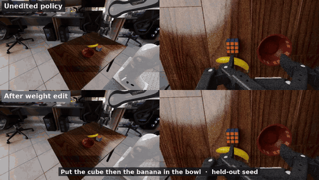

# weightsmith

**Let an LLM read, probe and edit a robot policy's weights — and measure whether it helped.**

[](https://adeeb10abbas.github.io/weightsmith/paper.pdf)
[](https://adeeb10abbas.github.io/weightsmith/)
[](LICENSE)

<p align="center">
  
  <br>
  <sub>Same instruction, same held-out start. Top: π0.5 as released drops the cube. Bottom: after a closed-form weight edit — no training.</sub>
</p>

weightsmith gives an LLM agent one tool, `owsp`, over OpenPI's π0.5 (3.35B parameters) running closed-loop in NVIDIA RoboLab. The agent reads weights, replays recorded decisions to capture activations, writes a closed-form edit (no gradients, no training, no black-box search) and tests it against the unedited policy on paired simulator seeds. Held-out seeds are scored by an operator, never by the agent.

## What you can do in 5 minutes

Each assumes a GPU host set up once with [docs/SETUP.md](docs/SETUP.md); the editor side is a `pip install`.

**Fix a misread instruction without training.** If the policy fails under one wording but succeeds under an explicit rewording, *closed-form instruction distillation* writes the rewording's effect into the weights. At each VLM layer, one regularized minimum-norm update, ΔW = Kᵀ(KKᵀ + λI)⁻¹V, maps the original prompt's MLP inputs (K) to the change the rewording makes in that layer's residual update (V). The paper's edit is [22 lines of NumPy](study/results/opus/ctb/v2mi_edit.py) run in the `owsp py` sandbox; [`ctb/`](study/results/opus/ctb/README.md) holds every failed attempt and offline check. A packaged `weightsmith distill` command is on the [roadmap](#integrations).

**Turn your MCP client into a policy editor.** `weightsmith mcp` serves the `owsp` tool surface as 10 typed tools (list tensors, replay activations, run NumPy on the weights, evaluate in closed loop), bound by the project's budget and sandbox. Claude Code:

```bash
claude mcp add weightsmith -- weightsmith mcp --root /data/wsp/projects/cube-then-banana
```

Claude Desktop, Cursor and the Codex CLI: [docs/INTEGRATIONS.md](docs/INTEGRATIONS.md).

**Ship an edit as one file.** `weightsmith edit` turns a candidate into a self-describing `.safetensors` file: low-rank where it can be, bit-exact when applied, and sha256-checked against the base weights.

```bash
weightsmith edit export $WSP_ROOT/cands/v2mi-f -o v2mi-f.safetensors --rank auto   # on the GPU host
weightsmith edit info   v2mi-f.safetensors                                         # what it changes, and how
weightsmith edit apply  v2mi-f.safetensors --workspace $BASE_WORKSPACE --out $WSP_ROOT/cands/v2mi-f-copy
```

## The benchmark

An editor practises on paired seeds under a budget and submits one frozen candidate, or `base`. The operator scores it against the unedited policy on at least 64 held-out paired seeds, and it is accepted at exact McNemar p < 0.05. There are 16 zero-shot RoboLab tasks, drivers for Claude Code and the Codex CLI, and a measured noise floor: with unchanged weights, about 30% of paired outcomes flip.

Protocol: [BENCHMARK.md](BENCHMARK.md). Every run, including the failures: [LEADERBOARD.md](LEADERBOARD.md). **No autonomous editor has an accepted edit yet.**

## Results

| Edit | Task | Unedited → edited | Seeds |
|---|---|---|---|
| Closed-form instruction distillation (`v2mi-f`) | Cube then banana | 27/128 → **106/128**: 81 fixed, 2 broken, p = 7×10⁻²² | held-out |
| Same, image cells in layers 8–16 only; factors = 0.16% of parameters (`abl-imgl8`) | Cube then banana | 19/128 → **102/128**: 86 fixed, 3 broken | held-out |
| `v2mi-f`, unchanged | Pick up eyeglasses | 22/64 → **44/64** | held-out |
| `v2mi-f`, unchanged | Cube left of the bowl | 8/64 → **36/64** | held-out |
| Edits aimed at perception, a missing skill, contact physics, the gripper threshold | Stacking, flat box, mustard, 7 tasks | no gain | practice |

Paired outcomes on identical seeds; p is the exact McNemar test. The distilled edit was built by our Claude Opus operator session following the editor rules, not by an autonomous editor run. Details: the [paper](https://adeeb10abbas.github.io/weightsmith/paper.pdf), the [project page](https://adeeb10abbas.github.io/weightsmith/), and the raw [held-out runs](study/results/opus/heldout/) and [comparisons](study/results/opus/comparisons.json).

## Quickstart

```bash
git clone https://github.com/adeeb10abbas/weightsmith && cd weightsmith
pip install -e '.[mcp]'                            # weightsmith CLI + MCP server (editor side, CPU only)
scripts/setup_deps.sh && cp .env.example wsp.env   # GPU host, once: pinned stack + checkpoint; then fill in wsp.env
scripts/prepare_workspace.sh                       # GPU host, once: editable bf16 export of the weights (~11 GB)
export WSP_ROOT=$PWD/projects/ctb && mkdir -p $WSP_ROOT && cp configs/cube-then-banana.json $WSP_ROOT/config.json
scripts/base_practice.sh 64                        # the unedited policy on 64 practice seeds: the paired baseline
bin/owsp status                                    # task, instruction, budget, candidates
bin/owsp new v1 && bin/owsp py v1 edit.py          # a candidate, edited by your NumPy script: save(name, bf16(W + dW))
bin/owsp eval v1 --n 64                            # the candidate in closed loop on the same 64 seeds, paired with base
python3 weightsmith/heldout.py --cand v1 --slot-start 90000 --n 128   # operator only: the held-out score
```

Requirements (Linux, 24 GB NVIDIA GPU, ~60 GB disk) and the exact pins are in [docs/SETUP.md](docs/SETUP.md). To run an autonomous editor instead, see [`drivers/`](drivers/) and [docs/COMPARING_EDITORS.md](docs/COMPARING_EDITORS.md).

## Integrations

| | Status |
|---|---|
| MCP server for Claude Code, Claude Desktop, Cursor and the Codex CLI (`weightsmith mcp`) | Ready |
| Headless editor drivers for Claude Code and the Codex CLI (`drivers/`) | Ready |
| Portable edit files (`weightsmith edit`): safetensors or npz, exact or low-rank | Ready |
| Hugging Face Hub folders for results and edits (`integrations/hub/`) | Experimental |
| `weightsmith distill`: closed-form instruction distillation as one command | Roadmap |

Setup and client configs: [docs/INTEGRATIONS.md](docs/INTEGRATIONS.md).

## Repository map

```
weightsmith/    owsp.py (the editor's tool), heldout.py (operator scoring), eval pool, activation capture,
                edits.py (portable edits), mcp_server.py, cli.py
bin/owsp        the editor-side wrapper, local or over ssh: the only command an editor gets
drivers/        headless editors: claude.sh (Claude Code), astra.sh (Codex CLI)
configs/ briefs/  task configs and editor briefs        scripts/  setup, workspace export, projects, smoke test
integrations/   MCP launcher, Hugging Face export       tests/    CPU-only tests: python3 -m pytest tests
study/          results, edit scripts and the full report (results/opus/, blog/failure-levels.md)
paper/ site/    the paper's LaTeX source and the project page
```

## Citation

```bibtex
@misc{abbas2026distilling,
  title  = {{Distilling Instructions into Weights: Closed-Form Edits Fix a Robot Policy's Misreading}},
  author = {Abbas, Ali-Adeeb and Seraj, Esmaeil},
  year   = {2026},
  url    = {https://adeeb10abbas.github.io/weightsmith/},
  note   = {arXiv preprint, forthcoming}
}
```

GitHub's "Cite this repository" reads the same entry from [CITATION.cff](CITATION.cff).

## License

MIT; see [LICENSE](LICENSE) and [NOTICE](NOTICE). OpenPI and the π0.5 checkpoint, RoboLab, Isaac Sim and Isaac Lab are separate dependencies under their own licenses.

## Acknowledgements

The policy and checkpoint come from [OpenPI](https://github.com/Physical-Intelligence/openpi) by Physical Intelligence (we use [a fork](https://github.com/xuningy/openpi) with request-scoped sampling seeds). Tasks and simulated evaluation come from [RoboLab](https://github.com/NVlabs/RoboLab) on [NVIDIA Isaac Sim](https://developer.nvidia.com/isaac/sim) and Isaac Lab. The editing protocol follows Takehi et al., [Weight-Space Programming](https://rikiyat.github.io/blog/weight-space-programming/).
