# Can a large model repair a robot policy by editing its weights?

**Ali-Adeeb Abbas and Esmaeil Seraj**  
Draft, November 5, 2026 (Pacific). **The completed 1,056-episode study did not establish reliable weight-space repair or an advantage from iterative editing.** Five searches produced only four actual weight edits. Unchanged-policy repeats varied substantially, and our diagnostic interface and acceptance rule had important limitations. This is evidence about a restricted implementation, not a general verdict against WSP or a matched reproduction of published successes.

A robot can understand an instruction and still fail at the last few centimeters. It may close its gripper too early, miss a placement, or knock over something it just stacked. Usually we respond with more data, a training run, or a change to the controller. Weight-space programming asks a different practical question: can a large reasoning model diagnose a repeatable failure and directly patch the policy that produces it?

The idea is compelling because the deployed policy already contains useful skills. A successful repair might reuse those skills with a small, inspectable parameter change. But changing few weights does not guarantee changing little behavior. The robot's actions change its next observations, so a patch can create failures that were invisible in the original recordings.

## What the first wave of work actually shows

[Sparks of Weight-Space Programming](https://rikiyat.github.io/blog/weight-space-programming/) brings together weight reading, construction of small policies, and tool-assisted model repair. Those are distinct accomplishments. Recognizing a small network's task is not the same as repairing a vision-language-action policy, and fixing a pathological loop is not the same as adding a missing skill.

The newer [robotics report by Gupta and colleagues](https://codnay.github.io/blog/llms-fix-robots-by-editing-weights/) describes direct edits that improve five of ten manipulation tasks. It also reports a stronger folding result obtained by adding a difference between trained models. That second procedure includes training in how the update was constructed, even though applying the update is simple weight arithmetic. Both are interesting; they answer different questions.

A November 5 addendum covers [Guo and Xie's robotics threads](https://x.com/Lingxiao234/status/2118048171649806424). They report a large gain from four parameter changes in one task and describe diagnosing features and attention before testing edits. Their clarification matters: the policies were already fine-tuned per task, and the reported scene transfer stays within a task. We located author reports, but no matching patch or evaluation-log release. Our [detailed assessment](../review/guo-xie.md) separates promising claims, verification gaps, and concrete implications for our next experiment.

Our [recent-work comparison table](recent_work_table.md) covers every work identified in the survey: methods, outcomes, evidence and limitations. It includes failures, mixed interventions and proposals. The table now separates intervention, reported benefit, and limitations, including our own study. Limited scope is not a reason to dismiss a result; it is a reason to state exactly which claim it supports. The main lessons are:

| Lesson | Why it matters for robots |
|---|---|
| Check ordinary baselines first | Better settings or a simple control adjustment may explain much of a gain. |
| Record how a patch was found | No gradients does not mean no data, fitting, rollouts or expensive search. |
| Measure what breaks | A repair can improve one failure while damaging previously successful behavior. |
| Evaluate the closed loop | Similar recorded actions do not guarantee successful physical interaction. |
| Separate deployment from discovery | A small deployed patch can require a large discovery effort. |

## What our result does and does not establish

All four edits changed policy outputs on fixed inputs, but none passed the frozen behavioral gate. Unchanged-policy repeats themselves routinely exceeded that gate's permitted breakages. We therefore cannot treat rejection as proof that an edit caused damage. Replay failures and incorrect failure annotations also weakened the evidence available to the editor. Those engineering limitations belong to our study and must not be generalized into defects of all WSP methods.

The practical message is caution about treating targeted demonstrations as routine, reliable, inexpensive optimization. A tiny patch can require substantial diagnosis, and a higher cohort score can occur with no weight change. The present evidence motivates better controls and a matched positive reproduction; it does not establish that WSP is ineffective. The next experiment should validate repeatability and annotations before search and calibrate its decision rule prospectively.

## Which policies and failures might be easier to edit?

Policy type is a useful experimental dimension, not a proven ranking. A state-input controller can expose physical variables directly. A vision-language-action policy must connect images and language to control. A world-action model may expose predictive structure while adding prediction error. These categories can overlap; the exact architecture and editable components matter more than a label alone.

Our working hypothesis is that a localized motor-control defect may be easier to diagnose and patch when the needed state and skill are already represented. Visual ambiguity, occlusion, or missing task competence can require different information or broader representation changes. A motor failure can still be distributed, and a visual defect can sometimes be localized, so this is not a universal rule. Our teammate's preliminary observations motivate this distinction; his cross-family measurements are pending and are not included in our numerical results. Our own single-VLA experiment cannot establish a motor-versus-vision advantage. The gripper adjustment was a runtime control, and changed camera inputs do not prove that perception caused the failures.

A useful next comparison separates policy family, failure mechanism, prior task training, editor access, and discovery budget. Evaluate a recurring control failure and a perceptual ambiguity separately, with independent diagnostic labels and repeated unchanged-policy controls. Report every tested task and regression, including failures to find an edit.

## Why game and image demonstrations do not settle robotics

The [original study](https://rikiyat.github.io/blog/weight-space-programming/) uses structured grid inputs for its small game policies and explicit physical state for its car-control repair. Its diffusion example identifies generated shapes from weights; it does not demonstrate improved generation. The [image-restoration paper](https://arxiv.org/abs/2611.04268) explicitly presents conjectures. These observations do not establish that WSP performs better for image models than for robots.

There is nevertheless a technical reason to treat robotics separately. Fixed-input image evaluation can preserve the stimulus while comparing outputs. In closed-loop manipulation, an edited action changes contact, object pose, the next camera image, and the state visited later. Occlusion, delayed terminal rewards, and imperfect resets make diagnosis and causal attribution harder. Games also have feedback, and image generators have distributed representations and sampling variation. The relevant distinction is the structure of the task and the quality of its controls, rather than a blanket claim that one modality is easy and another is hard.

## The earlier smoke test

We connected the unedited pi0.5 DROID policy to a stacking task, recorded what it actually saw and did, and checked whether a fresh policy process reproduced selected requests. The existing two RTX 4090 GPUs were sufficient after an isolated move to Isaac Sim 6. The host driver stayed unchanged.

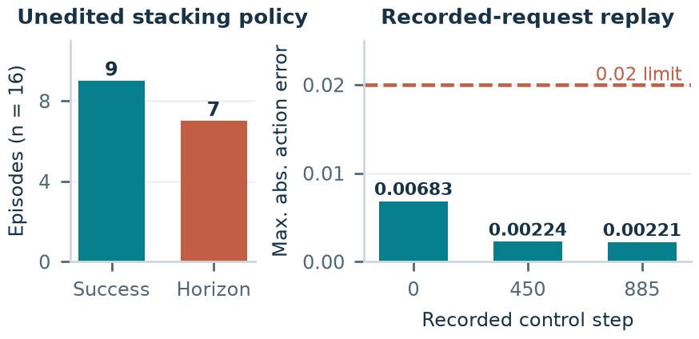

| Measured quantity | Result |
|---|---:|
| Completed episodes | 16/16 |
| Successful stacks | 9/16 |
| Recorded policy requests | 719 |
| Replay checks passed | 3/3 |
| Maximum action discrepancy | 0.00683, below the fixed 0.02 limit |

This is a working measurement pipeline, not yet evidence that weight editing improves the policy. The 16 episodes are a small practice cohort. We also retain an unsuccessful episode: passing replay means reproducing its policy computation faithfully, even when the task fails.

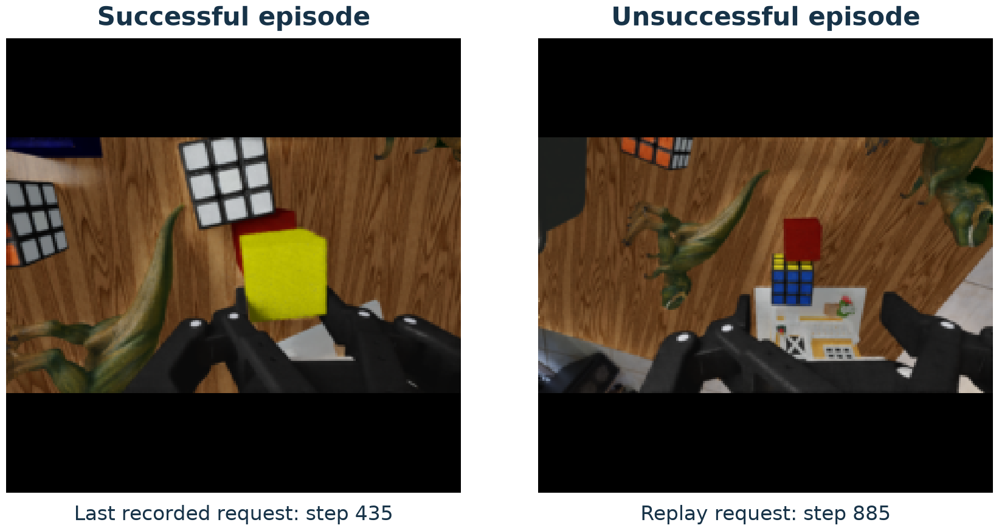

The images preserve the policy's original 224-by-224 inputs and black padding. The successful example is the last request before its terminal step, not a separate final-state screenshot.

<!-- BEGIN VERIFIED STUDY RESULTS -->
## The development baseline and runtime controls

The earlier smoke test completed 16 episodes with 9 successful stacks and 719 recorded requests. That remains a separate diagnostic cohort.

The fresh development baseline completed **11/32 successful stacks** on slots 20032-20063. The policy weights are unchanged. Different sampling slots and simulator variability mean this is not evidence of a policy regression from the earlier smoke.

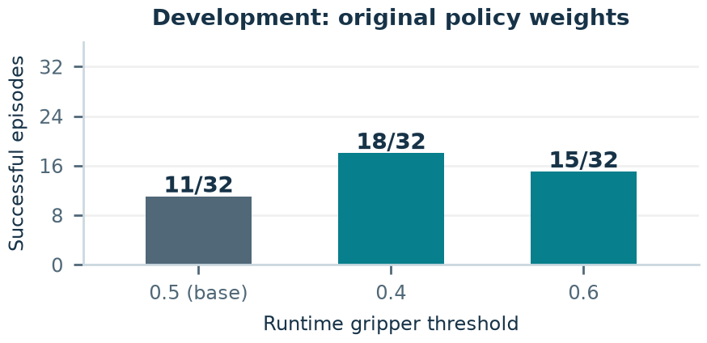

| Development setting | Successful stacks | Fixed / broken versus fresh base |
|---|---:|---:|
| Original policy, threshold 0.5 | 11/32 | Reference |
| Runtime threshold 0.4 | 18/32 | 14 / 7 |
| Runtime threshold 0.6 | 15/32 | 9 / 5 |

The development-only rule selected **threshold 0.4**. This changes gripper postprocessing, not the neural weights. Its held-out comparison scored 36/64 versus a fresh 23/64 baseline, but a separate unchanged-policy repeat also scored 35/64 versus 26/64. The development calibration alone does not establish improvement, and the final contrasts retain the repeatability limitations described below.

The restricted weight export also passed its identity check. All 18 exposed action-MLP slices matched the checkpoint, and the three replayed requests produced **exactly the same actions before and after loading the unedited export**. Against historical recorded actions, the maximum discrepancy was 0.00683, below the unchanged 0.02 tolerance. No comparisons were skipped.

The immediate capacity constraint was the 80 GiB container disk. Private staging of an 11.58 GiB checkpoint in RAM increased free disk from about 4.3 to 14.83 GiB. The restricted export needs only 288 MiB; it does not duplicate the whole checkpoint. This was a storage workaround, not evidence that the two GPUs or host RAM were insufficient. Existing shared project storage stayed untouched.

The frozen harness passed 147 CPU regression tests. The editor uses validated operations for tensor statistics, row scaling, and projections; the pod cannot create sandbox namespaces for arbitrary code. The editor configuration uses `gpt-6-astra` with reasoning effort `max` and the same initial 32 episodes for every original editor session.

The study separates sparse repair quality, iterative feedback, and behavioral preservation. Verified discovery outcomes are reported below; held-out outcomes remain separate from development selection.

**Replay is checked per capture.** The first three observed activation-capture attempts were `c1-postgrasp`: 32 requests, failed, maximum error 0.09474; `c2-stablehold`: 4 requests, passed, maximum error 0.00415; `c3-transfer`: 16 requests, passed, maximum error 0.00740. The fixed tolerance remains 0.02, with no skipped or invalid comparisons. The failed capture remains archived and charged. An external operator provenance audit verifies which captures contributed to reported edits; failed arrays are not technically inaccessible to the frozen tools. This first-three-attempt snapshot records 52/96 activation items, not the full-run budget usage. The initial three-request check therefore does not establish universal replay parity. A later targeted batch-size diagnostic is reported separately; it does not retroactively make the failed capture eligible.
<!-- END VERIFIED STUDY RESULTS -->

<!-- BEGIN VERIFIED EDITING RESULTS -->
## What the first edits actually did

A proposal is one evaluated candidate; an actual edit changes at least one deployed scalar weight. Each original run evaluated three proposals. Table 4 in the paper calls the number of actual edits **Nonzero**: A1 had one, A2 had two, and both non-adaptive runs had zero. The other submissions evaluated unchanged weights. The original actual edits changed 4,412, 1,543 and 791 scalar values; the separate fixed16 edit changed 6,225. These are not four iterations of one successful repair.

Only completed, provenance-checked blocks appear below. Each proposal is compared with the same pinned 11/32 development base. 'Fixed' and 'broken' mean observed outcome transitions, not causally attributed repairs or damage; an identity repeat is not a weight repair.

| Run / proposal | Success | Fixed / broken | Changed rows / values | Delta L2 | Accepted incumbent |
|---|---:|---:|---:|---:|---|
| adaptive-r1/p1 | 12/32 | 7 / 6 | 7 / 4412 | 0.022294 | base |
| adaptive-r1/p2 | 14/32 | 6 / 3 | 0 / 0 | 0 | base |
| adaptive-r1/p3 | 20/32 | 12 / 3 | 0 / 0 | 0 | base |
| nonadaptive-r1/p1 | 13/32 | 8 / 6 | 0 / 0 | 0 | base |
| nonadaptive-r1/p2 | 17/32 | 10 / 4 | 0 / 0 | 0 | base |
| nonadaptive-r1/p3 | 10/32 | 7 / 8 | 0 / 0 | 0 | base |
| adaptive-r2/p1 | 13/32 | 9 / 7 | 2 / 1543 | 0.0079591 | base |
| adaptive-r2/p2 | 14/32 | 7 / 4 | 0 / 0 | 0 | base |
| adaptive-r2/p3 | 13/32 | 7 / 5 | 1 / 791 | 0.0061165 | base |
| nonadaptive-r2/p1 | 12/32 | 9 / 8 | 0 / 0 | 0 | base |
| nonadaptive-r2/p2 | 8/32 | 7 / 10 | 0 / 0 | 0 | base |
| nonadaptive-r2/p3 | 12/32 | 9 / 8 | 0 / 0 | 0 | base |

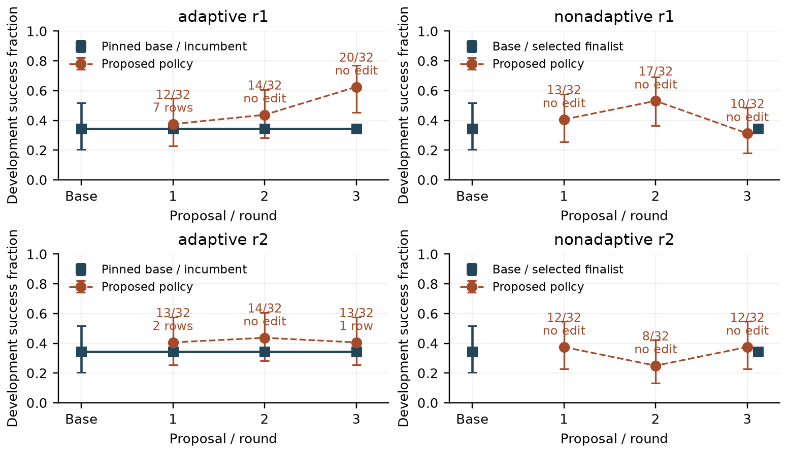

The acceptance rule requires more than 11 successes and at most two broken base-success episodes, plus a nonzero deployed weight change. A higher success count alone does not qualify. Accepted development scores are nondecreasing by construction; a retained incumbent reuses its recorded score. Error bars show nominal 95% Wilson intervals; selection and repeated use of development episodes limit their interpretation.

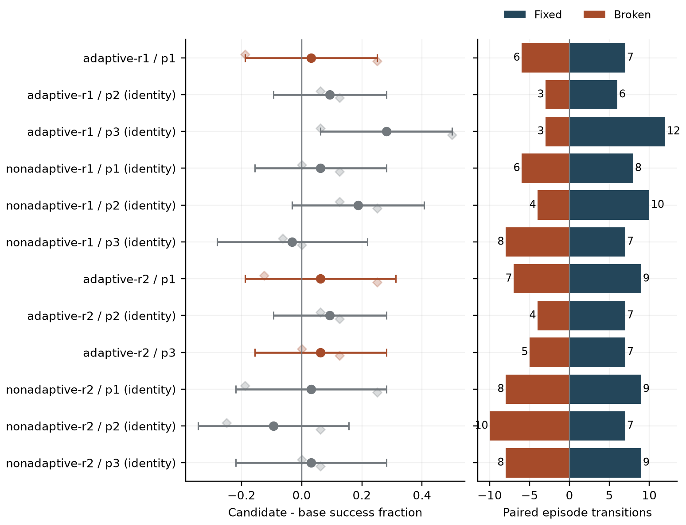

Paired difference intervals use 10,000 episode-slot bootstrap resamples. They describe this development cohort, not an unbiased test of a selected repair. Faint diamonds show the two 16-slot block means as a descriptive check, without claiming corrected interval coverage from two blocks. GPU-batched physics and reused streams can violate independence. Unfinished rounds have no plotted outcome.

This snapshot includes **12/12** scored proposals. 3 unique final comparisons have verified archives under the prospective amended plan. Held-out results are reported separately and never fed to an editor.

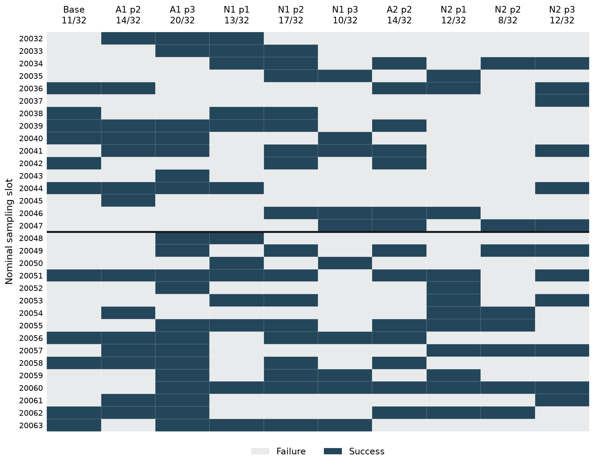

Each column is a separately recorded zero-edit rollout cohort; only completed, verified rows appear. Columns follow the actual evaluation order, with the pinned base first. The line splits the two 16-environment blocks. Matching nominal sampling seeds do not guarantee identical initial camera inputs. This descriptive map shows outcome turnover without pooling the repeated cohorts as independent binomial trials or treating identity fluctuations as learning.
<!-- END VERIFIED EDITING RESULTS -->

## Why replay batch size mattered

The failed activation capture contained 32 **separate single-request replays**, not a native batch of 32. We later ran an operator-only diagnostic on six recorded requests: the three largest failed-capture errors and the first three passing items. This deliberately selected sample can diagnose a mechanism; it cannot estimate how often it occurs.

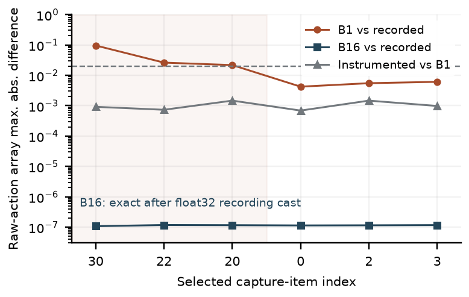

For identical observations and sampling seeds, native **batch size 16 reproduced all six historical action chunks exactly at the recorded float32 precision**. Its post-transform native outputs were float64; the apparent residual of at most **1.18 × 10⁻⁷** disappears under the recorder's float32 cast. Native **batch size 1** differed by up to **0.09566**. Saved instrumented outputs differed from native B1 by at most **0.001465**. Repeated native calls at the same batch size and loading the identity workspace changed actions by exactly zero.

Batch shape therefore accounts for the larger replay discrepancy in these six requests from five episodes. The largest discrepancy in each failed case was in the raw gripper channel, but **none of the 90 paired action rows changed its binary gripper decision at threshold 0.5**. A raw-action difference is not automatically a behavioral difference. B16 duplicated each request rather than reconstructing the original mixed microbatch; this sample does not explain all rollout variability or validate every replay. Editors did not receive this diagnostic. Failed arrays remain archived and charged; an external provenance audit verified that the first adaptive run did not use the failed capture to construct its edit. This audit controls inclusion, rather than relying on failed arrays being inaccessible.

## The unchanged-weight control deserves attention

The first edit changed seven rows and 4,412 deployed values. It achieved 12/32 successes, with seven base-failure/proposal-success transitions and six transitions in the opposite direction. Our preservation gate rejected it. The next two proposals changed **zero** values and shared the same workspace fingerprint, yet scored **14/32 and 20/32**. Their nominal fixes/breakages were 6/3 and 12/3. The entire first restart took 61.6 minutes and retained the original policy after every round.

The third proposal's nominal paired bootstrap interval was positive, **[0.0625, 0.5000]**, even though no weight had changed. That interval describes the observed cohort difference under its statistical assumptions; it cannot establish a parameter-change effect. The accepted incumbent curve stays flat. Its score is reused when the same policy is retained, while the proposed-policy curve records each actual evaluation. All nine identity repeats showed 3–10 nominal breakages against the pinned base, so none met the two-breakage preservation threshold even apart from the no-edit exclusion. This describes the gate's sensitivity to observed rollout turnover; the repeated cohorts are not independent trials and do not establish a calibrated acceptance error rate.

The first non-adaptive run ran into a different limitation: its three activation captures, with 28, 56, and 12 requests, all failed the unchanged 0.02 replay limit. Their maximum errors were 0.06615, 0.18194, and 0.02777. It used no failed-capture contrast and spent its full 96-item budget. It then precommitted three identity proposals before seeing any candidate outcome. They scored **13/32, 17/32, and 10/32**, with nominal fixes/breakages **8/6, 10/4, and 7/8**. The final policy remained base. This is evidence of abstention when the measurement interface did not produce usable activation evidence; it is not a test of three distinct weight repairs. Equal budgets do not guarantee equal usable evidence.

The second adaptive run produced two further nonzero edits: two rows / 1,543 deployed values (delta L2 0.007959), then one row / 791 values (0.006117). Both scored **13/32**, with nominal fix/break counts **9/7** and **7/5**, and both failed preservation. Its middle proposal was an identity, scoring 14/32. Only a four-item capture passed complete parity; 92 of its 96 logical activation items belonged to failed captures. The second non-adaptive run spent all 96 items on one failed capture and submitted three identities, scoring **12/32, 8/32, and 12/32**. All four finalists therefore remain base.

Across the four runs, **384/384 candidate episodes completed**. Of **368 charged activation items**, **24** belonged to completely validated captures, **316** to failed captures, and **28** to an unchecked diagnostic capture. A failed capture can contain individually passing requests, but those do not make the whole capture eligible. These are logical items, with repeated requests charged again, not independent simulator episodes. Actual driver durations were **61.6, 50.9, 67.3, and 47.6 minutes** in execution order; they include reasoning, tool work, simulation, and waiting. The [cost table](costs.md) preserves individual checks and unique source counts without making a training-cost comparison.

We compared the recorded inputs of the original base and the first adaptive run's p2 identity repeat, without running new episodes. All 32 pairs had the same initial robot joint positions and gripper input, and their recorded sampling seeds matched. Yet their first base-camera images, wrist-camera images, and action chunks differed in every pair.

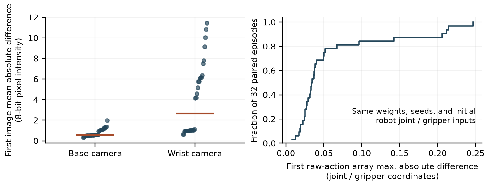

The median first-image mean absolute difference was 0.558 intensity levels for the base camera and 2.638 for the wrist camera, on a 0–255 scale. The median maximum difference in the first action chunk was 0.03397. These measurements identify a reproducibility limit; they do not isolate its cause. Object state, rendering, numerical execution, and closed-loop amplification remain possibilities to investigate. In particular, same sampling seeds and same initial robot proprioception did not mean identical policy inputs.

The [recorded-input clip gallery](../ARTIFACTS.md#full-review-bundle) shows nominal paired fixes, breakages, and unchanged outcomes for the edit, identity repeat, and runtime control. Examples follow a fixed rule: the lowest-numbered slot in each outcome category, rather than a visually selected success. These clips replay actual external-camera and wrist-camera inputs recorded about once per second. They are sparse input reconstructions, not full simulator videos, and different-input action differences are not checkpoint-parity tests. After the annotation audit described below, the publication version omits unvalidated event names and free-text diagnostic reasons, explains that omission in every frame, and preserves the original inputs, telemetry and terminal simulator flags. The original encoded videos and provenance remain archived unchanged. [Selection, timing, and versioned verification](../ARTIFACTS.md#full-review-bundle) accompany every clip.

The gallery also links two original **15 FPS simulator recordings** from the earlier 9/16 base-policy smoke cohort: the lowest environment ID among successes and among failures. Their [manifest](../ARTIFACTS.md#full-review-bundle) verifies byte-preserved copies of existing recordings. They illustrate the historical smoke run and are distinct from the 32-slot development comparisons.

## Three questions for a short study

Our success endpoint is the installed simulator's stacking predicate. A [source audit](../ARTIFACTS.md#full-review-bundle) confirms that it checks contact and relative block geometry, without an additional gripper-release, dwell-time, or velocity criterion. This defines what the reported success flag certifies; it does not establish that observed successes were unstable or still grasped. A release-and-settling test would need a separate prospective evaluation.

We also audited the textual failure feedback. The installed tracker passed condition-group names (`group1`, `group2`) as intended scene-object names, so it could label a grasp of the intended yellow block as “wrong object.” Across the 32 baseline summaries, **62 of 91 wrong-object events named the yellow block**, spanning **28 episodes, including all 11 successes**. The other 29 events named distractors or other objects and should not all be dismissed. The terminal success Boolean and condition-progress checks follow separate code paths; this audit found an annotation problem, not direct corruption of the success score.

Editors did receive these unvalidated annotations. The audit does not establish whether or how they relied on them, so biased semantic feedback is a limitation of both frozen v1 and v2 setups. We retain the original records and do not retroactively relabel outcomes. The [source audit and census](../ARTIFACTS.md#full-review-bundle) document the evidence. A separately [reviewed metadata correction](../ARTIFACTS.md#full-review-bundle) remains **unapplied**; it needs a future versioned integration test, including other target-dependent event annotations.

**Does a sparse edit help?** We will compare a frozen edit with the original policy and a simple gripper calibration on unseen sampling seeds. The instruction, checkpoint, simulator and scoring rule stay fixed. The current task has a fixed scene, so success on new noise seeds will not be described as generalization to new objects or layouts.

**Does the improvement loop help?** A large editor can inspect failures, propose a patch, observe new outcomes, and try again. To test whether feedback matters, we will compare three adaptive rounds with three proposals made before any candidate feedback is returned. Both arms get the same number of evaluations. This avoids mistaking extra trials for a benefit of iteration.

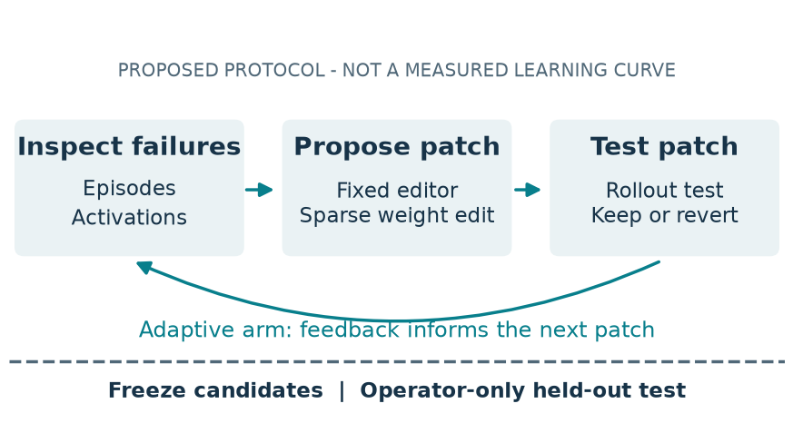

**What behavior is preserved?** We will count nominal fixes and breakages, retain intermediate checkpoints, and repeat base evaluation to measure rollout variability. The frozen core includes only stacking; cross-task preservation needs a separate future study. Astra-versus-Opus remains optional under matched feedback caps; a few runs will not establish a universal model ranking.

The original final schedule had nine fresh base/candidate comparisons plus an extra base repeat. Before any held-out outcomes, a **prospective v1.1 amendment** was recorded at 09:49 UTC on November 5: identical deployed policies will share one estimate, while the original round and finalist labels remain in a mapping. This avoids treating repeated names for the same policy as independent learning measurements. All four original discovery runs completed without changing their frozen design, and every failed attempt remains charged.

Each unique edited policy, the identity control, and the runtime control receives a fresh 64-episode base evaluation and 64 candidate episodes in fixed 32-episode base/candidate/candidate/base blocks. An extra 64-episode base repeat uses the identity comparison's base. Final capacity is **320 + 128 × the number of unique edited policies**; the reduction depends on which policies discovery actually produces. The amendment sacrifices some repeated-policy precision. Pairing aligns nominal sampling streams but does not guarantee identical starting images or reduced variance; the global comparison order is fixed. The separate batch-aware exploratory follow-up used its own versioned setup and candidate freeze before held-out feedback; its results are not pooled with v1.

## A separate batch-aware follow-up

The new v2 protocol is a prospectively specified exploratory study, not a corrected score for v1. It plans one adaptive Astra run with three 32-episode proposal evaluations and 96 logical activation items. The original checkpoint, 128-row/two-layer limit, typed operations, and acceptance rule stay the same, but the numerical runtime and baseline change.

Every live inference packet is padded to 16. The recorder preserves its actual members, positions, padding, individual sampling seeds, and outputs; activation replay reconstructs the whole packet and checks every real position without skips. Noise is generated separately for each request using its own seed, then concatenated and padded, matching the server rather than replacing those keys with one batch-wide draw. Activation features use float32, which exactly represents the bfloat16 values, instead of v1's float16 exports; raw requested-site traces retain their original dtype and bits. Thus batching is not the only numerical-interface change. The record will count full padded computation as well as logical activation items. A fresh 32-episode baseline uses development slots 30016–30047, with disjoint final streams 100000–100063.

The protocol is pinned, and numerical GPU validation passed at about 12:29 UTC on November 5. The fresh baseline completed all 32 episodes at 12:40 UTC with 17 successes, and the adaptive search began after its reference records were frozen. The completed proposal results and both held-out identity comparisons are reported below; the original gripper control and extra repeat are also complete. The measured readiness result and preserved preflight failure are reported below. A future failed capture still remains failed and charged; this check does not validate unseen requests. All v1 and v2 searches have now closed. Their shared candidate freeze precedes either version's held-out results. The operator declared v2 final scoring first, then v1.1, before observing any v2 proposal score; both analyses remain required and separate. V2 will be analyzed separately: a new runtime, new baseline, and one editor run cannot support a causal v1-versus-v2 performance comparison or a model ranking.

## Is this reinforcement learning or a world model?

The proposed loop shares a goal with reinforcement learning: improve a policy using feedback from an environment. The absence of gradients is not the decisive distinction; [derivative-free policy search already exists](https://arxiv.org/abs/1703.03864). Here, policy weights change through feedback-guided proposals, while the large editor's own weights remain fixed. No policy-gradient or value-function update, or optimization of the editor's weights, is used. “Language-model-guided derivative-free policy search” describes the implementation. The editor may compute success-minus-failure means and projection directions from observed activations; avoiding gradient optimization does not mean avoiding data or statistics.

A [learned world model](https://arxiv.org/abs/1803.10122) predicts how the environment evolves and can support [imagined rollouts](https://arxiv.org/abs/1912.01603). We are not learning such a predictor in this study. A language model's plausible explanation of a missed grasp is not, by itself, a validated dynamics model. Future systems could combine learned prediction with weight editing, but they would need to measure the errors of both components.

The useful outcome of a short investigation is therefore narrower and testable: a reproducible local repair, a clear account of its cost and regressions, or evidence that a seemingly promising edit does not survive evaluation. Any of those would help turn an exciting concept into a method researchers can assess.

The [approved schedule and evaluation budget](../ARTIFACTS.md#full-review-bundle) target Saturday, November 7. RQ1-RQ3 take priority; Astra-versus-Opus remains optional. The frozen study is now complete; this paper and post include all verified final controls and separate fixed-input diagnostics.

<!-- VERIFIED COST TABLE LINK -->
The [recorded discovery effort table](costs.md) tracks actual driver wall time, reserved candidate episodes, and capture validation costs. Logical replay items, individually checked requests, and unique source episodes are counted separately; no dollar or training-cost comparison is implied.

The [four fixed16 development clips](../ARTIFACTS.md#full-review-bundle) show the first completed nonzero proposal, selected by chronology regardless of its score. Each nominal outcome category uses its lowest-numbered slot. All four selected pairs have different initial camera inputs; these 1 Hz recorded-input comparisons illustrate outcomes, not causal edit effects. Every request in the eight source episodes was checked against its native packet, and the clips omit unvalidated event diagnoses.

<!-- BEGIN VERIFIED V2 RESULTS -->
## Separate fixed-batch follow-up

The v2 publication snapshot is **complete**. It contains 3/3 verified proposal evaluations and 1 verified final comparison. This version changes batching and activation-export precision, starts from a fresh development baseline, and remains separate from the original four searches.

**Fresh fixed16 baseline: 17/32 successes (53.1%).** All 32 episodes completed on development streams 30016–30047 at threshold 0.5, with no threshold tuning. The baseline simulation block took 653.23 seconds. This count is a separate reference for v2 proposals; its difference from v1's 11/32 is not an estimate of a runtime improvement.

| Proposal | Success | Nominal fixed / broken | Changed rows / values | Delta L2 | Accepted incumbent |
|---|---:|---:|---:|---:|---|
| p1 | 11/32 | 5 / 11 | 8 / 6225 | 0.02643 | base |
| p2 | 14/32 | 5 / 8 | 0 / 0 | 0 | base |
| p3 | 14/32 | 4 / 7 | 0 / 0 | 0 | base |

The closed editor run used 63.43 wall minutes and completed 96/96 reserved candidate episodes. It requested 80/96 activation items: 80 in fully validated calls, 0 in failed calls, and 0 unchecked. The 4 calls used 192 padded forward positions, with native and instrumented work counted separately from logical requests. Detailed unique-source counts and provenance are in the [effort table](costs.md). Usable activation measurements do not themselves establish a causal mechanism or successful edit.

| Proposal | Difference from fresh base | Nominal paired 95% bootstrap interval |
|---|---:|---:|
| p1 | -0.1875 | [-0.4062, 0.0625] |
| p2 | -0.0938 | [-0.3125, 0.1250] |
| p3 | -0.0938 | [-0.2812, 0.0938] |

These intervals describe selected development cohorts under nominal independent-slot assumptions. They do not establish an edit effect, valid coverage under shared-environment dependence, or a comparison with v1.

Identical deployments p2 and p3 disagreed on **10/32** nominal slot outcomes, despite their matching workspace fingerprint. Equal aggregate success counts can hide substantial per-slot turnover. This is repeat-evaluation variability, not learning.

**GPU readiness passed:** 31 real positions in five packets (real counts 1/2/4/8/16, padded to 16), using 16 distinct legacy first inputs to record new fixed16 native packets. Native repeats, identity loading and native replay of those packets were exact. The maximum instrumented-versus-native raw-action-array difference was 0.00246380, below 0.02, with zero skipped positions. The corresponding client-format float32 comparison was 0.00246380; these were offline validation arrays, not new simulator episodes. Joint channels and the raw gripper channel have different semantics; this aggregate is not a Cartesian displacement or a common physical unit. The check took 32.385 seconds and completed 400 padded forward positions, including native controls and the production capture worker. It generated no new simulator episodes or editor evidence. This is an action-parity check on these requests, not proof of internal activation identity, universal replay parity, or closed-loop improvement.

A preceding operator preflight failed because three already-pinned support files were absent. Its failed queue/preparation records and logs remain preserved and hash-bound. A separate explicit continuation added only those files, prepared the final plan with zero reserved episodes, and continued the unchanged scientific stages. It did not repeat pruning or reset a scientific budget. The numerical readiness result above belongs to the subsequent actual GPU attempt.

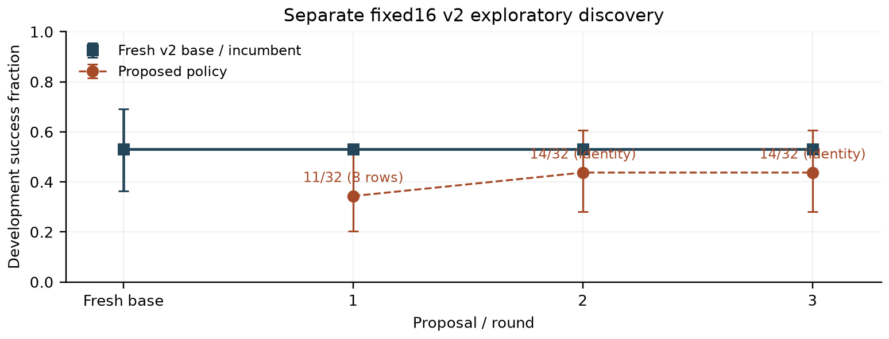

Development error bars are nominal Wilson intervals, and retained incumbents reuse their earlier observation. Pending rounds have no inferred score. The held-out adapter reports one estimate per unique deployment; repeated round labels share that estimate. V1 and v2 are never pooled.

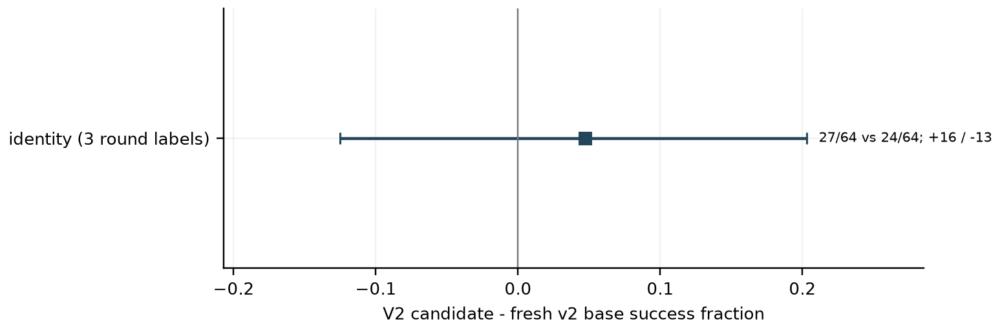

The [v2 final table and role mapping](generated_final_v2.md) populate only from fully verified local archives, including native batch packets. The [v1.1 final table](generated_final_v1p1.md) uses its own protocol, runtime and streams.
<!-- END VERIFIED V2 RESULTS -->

## Final controls: unchanged weights still change outcomes

The fixed16 identity comparison completed all **128 episodes** and was fully archived at **15:03:44 UTC on November 5**. The two deployments used identical policy weights and the same runtime: the fresh reference scored **24/64**, and the identity candidate scored **27/64**. There were **16 nominal fixes and 13 nominal breakages**, so **29/64 paired slots changed outcome**.

The candidate-minus-reference difference was **4.69 percentage points**, with a **nominal paired 95% bootstrap interval from -12.50 to +20.31 points**. This is an unchanged-policy cohort difference, not a WSP effect or an equivalence result. Shared simulation execution, nominal rather than pixel-identical pairing, and fixed execution order limit the interval's interpretation. All three fixed16 round labels share this one estimate; they are not three independent tests or an improvement curve.

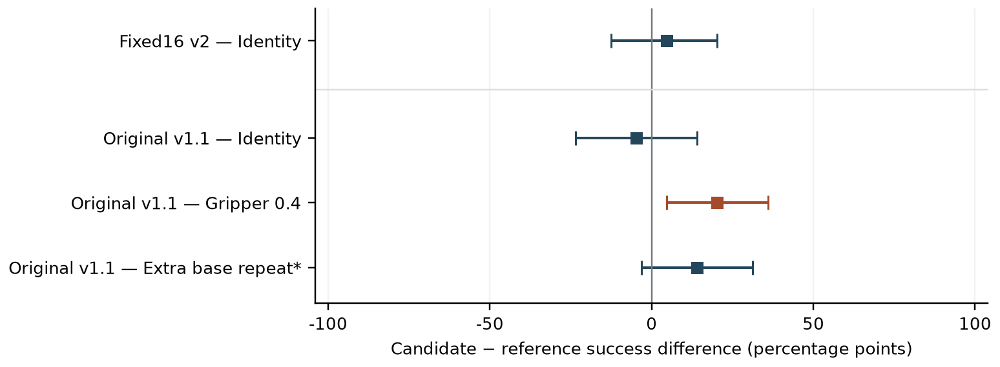

The original-runtime identity comparison is also verified: **26/64 versus 23/64**, with **17 nominal fixes and 20 breakages** (37/64 discordant outcomes). Its difference is **-4.69 percentage points**, with a nominal paired 95% bootstrap interval of **[-23.44, +14.06] points**. This is another unchanged-weight control, not evidence of a policy edit. The selected **gripper threshold of 0.4 scored 36/64 versus 23/64** for its fresh reference, with **21 nominal fixes and 8 breakages**. Its difference was **+20.31 percentage points**, with nominal paired 95% interval **[+4.69, +35.94] points**. This is a runtime-only intervention, not WSP.

The **extra unchanged-policy repeat scored 35/64 versus its reused 26/64 reference**, with **21 fixes and 12 breakages**. Its nominal difference was **+14.06 points**, interval **[-3.13, +31.25]**. Thus a substantial positive difference also appeared without editing weights or changing the threshold. The extra repeat and original identity contrast share their reference and are correlated; the gripper control has a fresh reference. These comparisons do not isolate a causal gripper benefit. We do not pool runtimes, count shared labels as extra observations, or substitute rejected edits into held-out selection.

The unchanged-weight controls also expose a limitation of our acceptance gate. Original development identity repeats broke 3–10 nominal base successes, while this fixed16 held-out identity comparison broke 13. The predeclared gate allowed at most two breaks. Rejection therefore cannot, by itself, establish that an edit caused the failures. These controls motivate calibrating a future preservation rule to repeatability, while retaining this study's original rule and all rejected outcomes.

## What differs before the first action?

After seeing the fixed16 identity outcomes, we inspected the **first recorded request in all 64 paired slots**, without selecting examples by success. Initial joint values, gripper state, instruction and sampling seed matched exactly in every pair. Both camera images and the predicted 15-step action chunk differed in every pair.

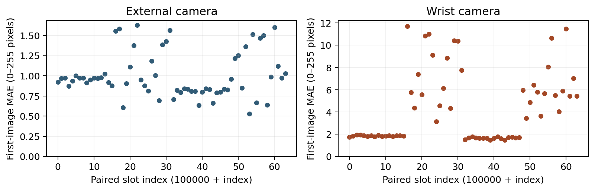

The median image mean absolute difference was **0.949 external-camera intensity units** and **2.546 wrist-camera intensity units**, on the 0–255 scale. These are pixel-intensity differences, not spatial displacements. Among the 960 planned gripper commands in the first chunks, **31 crossed different sides of the fixed 0.5 threshold**, across 7 of the 64 pairs. Planned commands are not a count of executed closures or causal failures.

This is a **post-hoc observational audit**, not an experiment isolating rendering or initialization. Different pixels can reflect several mechanisms, and we have not separated their contribution from batch context or numerical execution. The result explains why matching robot state and random seeds is insufficient to call these pixel-identical trials. The [audit, per-slot measurements and checksums](../ARTIFACTS.md#full-review-bundle) preserve the analysis; no new episodes or GPU calls were used.

## Separate post-freeze diagnostic failures

Two optional fixed-input action-effect diagnostics failed on their first native forward under the pinned GPU memory allocation. The original-runtime attempt completed **0/24** forwards in **29.83 seconds**; the fixed16 attempt completed **0/16** in **83.25 seconds**. Neither produced an edited-policy action array or a validated effect estimate. These are retained infrastructure failures, not evidence that the edits have zero effect. The [verified diagnostic record](../ARTIFACTS.md#full-review-bundle) preserves both attempts. The separately versioned resource-only successors have now completed and are reported below; the original failed attempts remain preserved.

## Do the weight edits actually change the predicted actions?

Yes, on the fixed inputs we tested. After all main evaluations closed, we ran a separately recorded allocation-only successor for each failed diagnostic. It enabled JAX GPU preallocation while retaining the same 0.40 memory fraction, inputs, edits, comparisons, and 600-second cap. The original attempts remain failures; this does not retroactively change their status. Both successors passed: **24/24 native forwards in 70.44 seconds** for the original runtime and **16/16 in 100.79 seconds** for fixed16. Repeat, unchanged-weight load and base-restoration checks were exact. The fixed16 native-versus-recorded checks also passed.

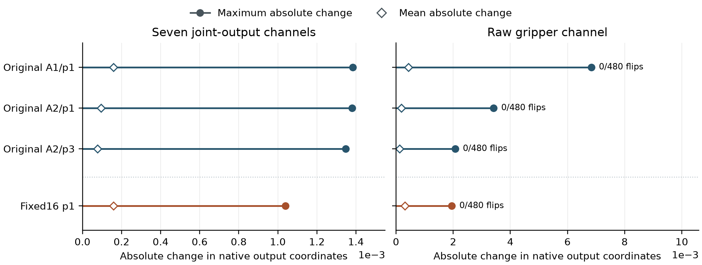

| Runtime / proposal | Maximum joint-channel change | Maximum raw-gripper change | Binary gripper flips |
|---|---:|---:|---:|
| v1 / adaptive-r1/p1 | 0.001384 | 0.006835 | 0/480 |
| v1 / adaptive-r2/p1 | 0.001379 | 0.003417 | 0/480 |
| v1 / adaptive-r2/p3 | 0.001347 | 0.002075 | 0/480 |
| v2 / p1 | 0.001039 | 0.001953 | 0/480 |

Each runtime uses **32 first recorded requests**, each predicting 15 actions. The 480 action rows are not independent trials, and these counts do not describe executed gripper closures. Joint-position outputs and the raw gripper scalar use separate coordinates; the numbers are not Cartesian distances. The three original edits use newly assembled mixed batches of 16; the fixed16 edit uses its authentic recorded packet context. We do not rank their magnitudes across runtimes.

The edits therefore have a measurable fixed-input effect. Zero threshold crossings in these samples do not imply no effect later in a rollout, no joint-motion effect, or successful behavioral preservation. This diagnostic does not establish a task-success improvement. The [separate-attempt record](../ARTIFACTS.md#full-review-bundle), [per-channel figure](figures/fixed_input_action_effects_per_channel.png), and [verified measurements](../ARTIFACTS.md#full-review-bundle) retain the complete evidence.

## Conclusion: conditional promise for Physical AI

WSP offers promising targeted repairs, but the evidence is too early to treat it as routine, reliable policy improvement. Our completed study showed no accepted weight-space gain or improving accepted-policy trajectory. Its implementation and measurement limits also prevent a broad negative verdict.

1. **State the conditions.** Report policy family, prior training, failure mechanism, and editor access. Treat motor-versus-perception and cross-family differences as hypotheses until matched evidence arrives.
2. **Validate measurement before attribution.** Check annotations, fixed-input replay, and unchanged-policy variation before claiming fixes or breakages.
3. **Measure behavior and total effort.** Sparse patches and output changes do not establish closed-loop efficacy, retained skills, or cheap discovery. Include failed probes, simulator integration, repeated evaluations, and all attempts.
4. **Build confidence through matched tests.** Reproduce positive cases, calibrate future gates prospectively, and evaluate selected patches independently. Keep the current frozen results and rejected proposals unchanged.
