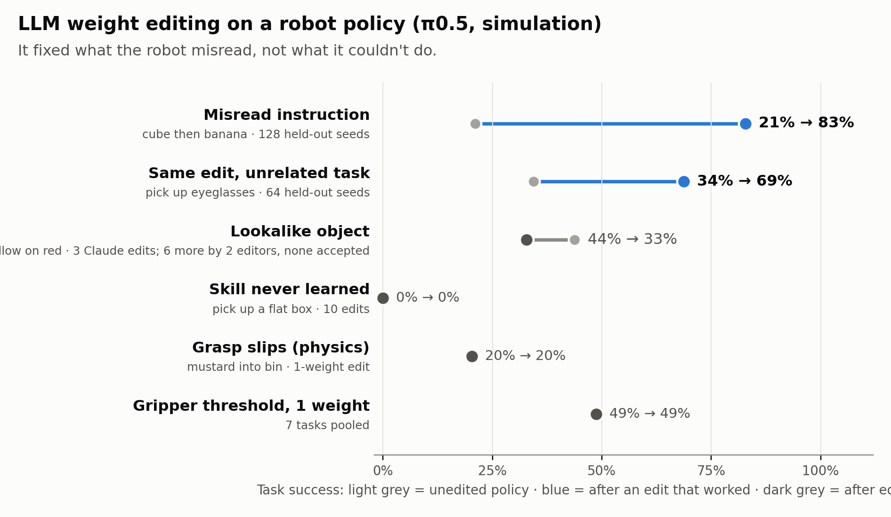
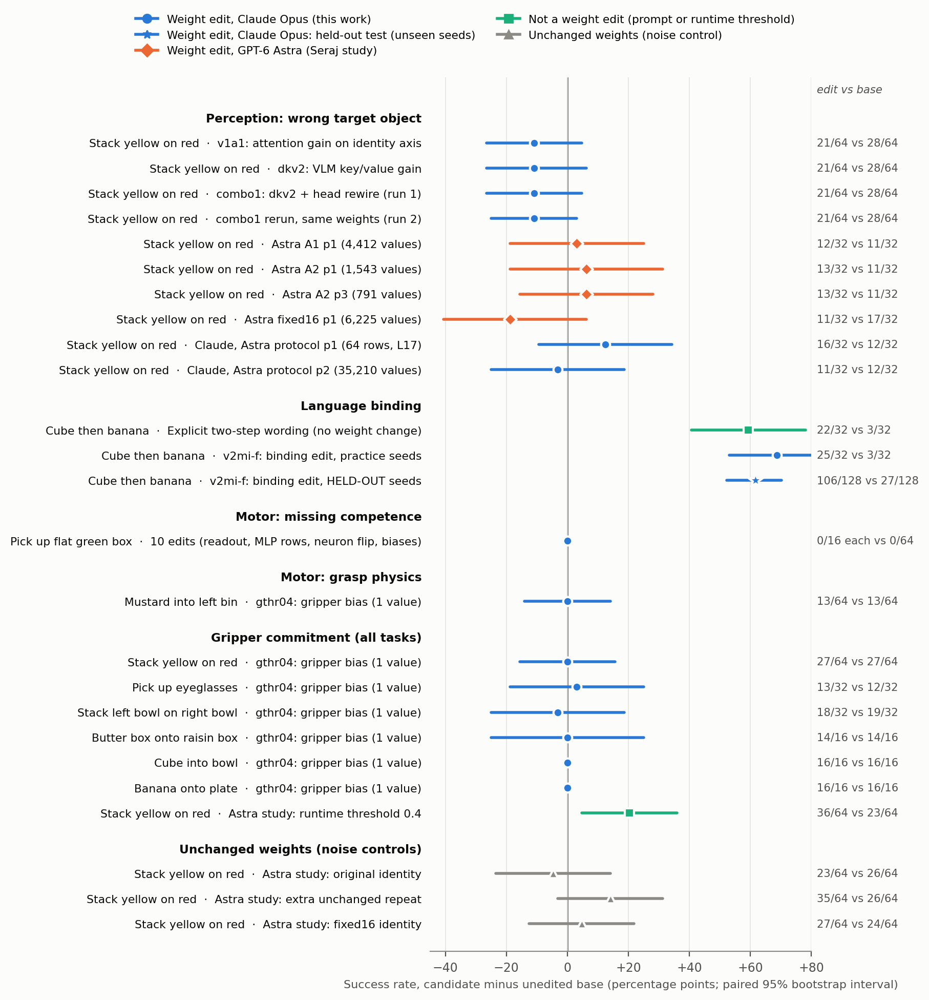
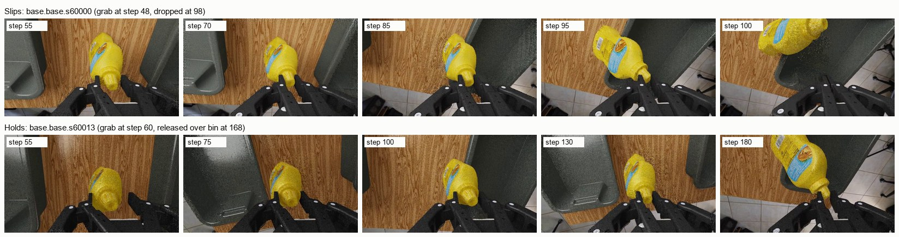

# Editing a robot's weights fixed what it misread, not what it couldn't do

*What LLM weight editing can and can't do for a robot policy: one clear success and many instructive failures on π0.5.*

**Ali-Adeeb Abbas and Esmaeil Seraj**  
Draft for coauthor review, November 6, 2026. Companion to the completed [Astra study](draft.md). Measured results, others' reports and our hypotheses are labelled as such throughout.

*Figure 1. Task success before (light grey) and after weight edits. The edit that worked (blue) fixed a misread instruction and transferred to two other tasks. The ones that did not (dark grey) targeted perception, a missing skill, contact physics, or a single gripper weight. All comparisons are paired on identical simulator seeds; the three blue rows are held-out.*

## TL;DR

- **The setup.** We let frontier models (Claude Opus; GPT-6 Astra in the companion study) read and edit the weights of π0.5, a 3.35B-parameter robot policy, directly. There was no training, no gradients and no fine-tuning data. We tested 16 simulated manipulation tasks.
- **One clear win: a misread instruction.** On "Put the cube then the banana in the bowl", the robot kept dropping the cube. We traced the cause to how the language model binds "in the bowl", then wrote a closed-form edit into the network.
  - Success went from **3/32 to 25/32** on practice seeds.
  - On **128 held-out seeds it never saw**, success went from 27/128 to 106/128.
  - The instruction itself was never changed.
  - **A random edit of exactly the same size does nothing.** Same layers, same rank, same singular values, random directions: 9/64 on held-out seeds, the same as the unedited policy (13/64 and 9/64 in two runs), against 50/64 for the real edit on those seeds.
  - **It recovers most of the rewording's effect.** The explicit wording itself, given to the unedited policy, scores 57/64 on the same seeds; the full edit (50/64) and the 0.16% version (54/64) are not detectably different from it (p = 0.12 and 0.63), and they keep the original instruction.
  - **A 0.16% version works as well.** Restricted to image regions in 9 layers (5.3M parameters as low-rank factors), it scores 19/128 → 102/128 on the same held-out seeds.
  - **It transferred to two other tasks.** On held-out seeds, eyeglasses went 22/64 → 44/64 and "put the cube to the left of the bowl" went 8/64 → 36/64. Twelve other tasks showed no reliable change either way.
- **Physical failures resisted every edit:**
  - a grasp that slips: no gain;
  - a skill the policy never learned: 10 edits, 0 successes;
  - grabbing the wrong yellow object: 9 edits across two editors, including Claude under Astra's exact protocol, no gain;
  - a one-weight gripper tweak on 7 tasks: 117/240 vs 117/240.
- **The pattern.** Weight editing can re-route what a network already knows. It cannot create what it doesn't.
- **Measure carefully.** About a third of episodes flip outcome between identical runs. A 16-episode "improvement" is noise until shown otherwise.

*Figure 2. Every closed-loop comparison in this work and the companion Astra study. Each row shows success with the intervention minus success without it, on the same simulator seeds, with a paired 95% bootstrap interval. Blue: weight edits by Claude Opus. Orange: weight edits by GPT-6 Astra. Green: changes that are not weight edits. Grey: the unchanged policy rerun. Star: the held-out test of the one edit that worked, on seeds never used during editing. Right column: successes with vs without.*

## 1. The question

A robot policy can see the scene correctly and still fail at one step: it drops an object, grabs the wrong one, or closes its gripper a moment too early. The usual fix is more data and another training run. **Weight-space programming** proposes something different. Let a reasoning model look inside the network, find the computation that goes wrong, and patch the weights directly, the way a programmer patches code ([Takehi et al.](https://rikiyat.github.io/blog/weight-space-programming/)).

Early reports on robot policies are striking, and our companion study is sober (§2). We asked the question that decides whether this matters in practice: **which kinds of robot failure can it fix?**

## 2. What others have found

These are **reported** results, not ones we reproduced. Esmaeil's [literature survey](../review/literature-survey.md), [evidence table](recent_work_table.md) and [Guo–Xie assessment](../review/guo-xie.md) go into detail.

| Work | What was edited | Reported outcome | Note |
|---|---|---|---|
| [Takehi et al.](https://rikiyat.github.io/blog/weight-space-programming/) | Small policies and language models | Read, built and repaired networks without gradients | Not a large robot policy |
| [Guo and Xie](../review/guo-xie.md) | π0.5 readout and attention | One task 28/92 → 82/92 with 4 changed parameters; RoboTwin aggregates 31% → 47% (single edit) | Checkpoints already **fine-tuned on each task**; recurring failure such as "hovers, never presses" |
| [Gupta et al.](https://codnay.github.io/blog/llms-fix-robots-by-editing-weights/) | π0.5 neurons on 10 tasks | Direct gains on 5/10 tasks; folding 51% → 75% | The folding update uses a difference between trained models |
| [Seraj, Astra study](draft.md) | Action-MLP rows of the generalist π0.5 | 4 edits on stacking, none accepted; large unchanged-policy variability | The companion to this report |

The positive reports share one feature: the robot already had the skill, and something specific went wrong when using it. That turns out to be the right lens.

## 3. Setup

- **Policy.** OpenPI `pi05_droid_jointpos`, about 3.35B parameters:
  - a PaliGemma vision-language model (VLM; 18 layers);
  - a Gemma action expert (18 layers) that turns the VLM's context into 15-step action chunks by flow matching.

  It was trained on real-robot DROID data, **not on any of our tasks**, so every result here is zero-shot.
- **Simulator.** NVIDIA RoboLab (Isaac Sim), 16 tasks, 16 parallel environments per evaluation. A *slot* fixes a run's random seeds and scene.
- **Editors.** Claude Opus (this report) and GPT-6 Astra (companion study), each running headless. They can:
  - read and write all weights in a numpy sandbox;
  - capture activations on the exact inputs of any recorded decision;
  - roll the policy out in simulation.
- **Rules:**
  - no gradients, optimizers, fine-tuning or black-box search;
  - every edit is a closed-form computation from weights and activations;
  - every edit has a hypothesis written down before it is evaluated;
  - the instruction text is fixed.
- **Scoring.** Every comparison is paired on identical slots with an exact McNemar test and a paired bootstrap interval. The one edit that passed practice was scored by the operator on **128 unseen slots**, with base and edit run in alternating order.

## 4. Results at a glance

We first ran the unedited policy on 16 tasks (256 episodes) and sorted every failure into a level. The full survey is in Appendix A. Here is what happened when we tried to edit each level:

| Level | What goes wrong | Example | Weight editing |
|---|---|---|---|
| **Language binding** | The instruction is parsed so the wrong object counts as "current" | Cube then banana | ✅ **3/32 → 25/32** practice; held-out 27/128 → 106/128; transfers to eyeglasses (22/64 → 44/64) and cube-left-of-bowl (8/64 → 36/64), both held-out |
| **Perception** | Goes for a similar-looking wrong object | Stack yellow on red | ❌ 3 Claude edits −11 pp; 4 Astra and 2 Claude edits under the same protocol, none accepted |
| **Missing skill** | Never produces a working motion | Pick up a flat box | ❌ 10 edits change the motion, 0 successes |
| **Contact physics** | Right decisions, but the grasp slips | Mustard into bin | ❌ No decision-level lever; edits stopped by offline checks |
| **Gripper commitment** | Close/open decisions near the threshold | All tasks | ❌ One weight, 7 tasks: 117/240 vs 117/240 |
| **Motor decision, skill present** | A competent skill stalls at one step | *None in our 16 zero-shot tasks* | — (others report large gains here) |

The edit that worked did not invent anything. The robot could already do the task: worded explicitly, the *same* weights succeed 22/32 times. The edit made the network process the original wording the way it processes the explicit one. Every failed edit targeted something the network does not compute correctly under any input: a grasp it never learned, contact physics, or an object distinction it never routes to its actions.

## 5. The success: fixing a misread instruction

### 5.1 The failure

Task: **"Put the cube then the banana in the bowl."** Unedited success: 9/64 (14%).

The robot starts correctly, going for the cube first in 63 of 64 episodes. Then it grasps the cube, lifts it a few centimetres, and **lets go** well short of the bowl. When the cube does reach the bowl first, the episode usually succeeds (about 7 in 9). So the skill is present, and one decision breaks it.

### 5.2 The diagnosis (Claude Opus)

The editor replayed 21 recorded premature-release decisions with the camera images, robot state and noise held fixed, changing only the instruction:

| Instruction at the replayed decisions | Releases (of 21) |
|---|---:|
| "Put the cube then the banana in the bowl" (original) | 21 |
| "Put the rubiks cube then the banana in the bowl" | 21 |
| "Put the banana then the cube in the bowl" | 3 |
| "Put the cube in the bowl then the banana" | 3 |
| "Put the cube in the bowl then put the banana in the bowl" | 2 |
| "Put the cube in the bowl" | 1 |

What the replays show:
- **"In the bowl" binds to the nearest noun.** While holding the cube, the policy concludes it holds the *wrong* object (the target is "the banana in the bowl") and drops it. Renaming the cube changes nothing, while moving "in the bowl" next to it fixes the drop.
- **Attention confirms it.** In the VLM, the destination words attend to the adjacent noun far more than to the first one (layer 1 head 1: 0.69 vs 0.02).
- **The skill is there.** Closed-loop with the explicit wording, the same weights succeed **22/32** against 3/32 on the same seeds.

### 5.3 Three attempts that failed first

All of these were stopped by offline replay before any rollout. Each taught something:

1. **Steering along the correlated "which object" axis.** Image tokens in VLM layers 10–16 carry a cube-vs-banana score that tracks the wording. Pushing it to three times what the explicit wording produces flipped **0 of 21** releases. *Correlated is not causal.*
2. **Copying the average shift at the robot-state tokens.** The action expert spends 33–58% of its attention on the instruction and robot-state tokens. Reproducing the explicit wording's *average* change there also flipped **0**.
3. **Copying the per-token shift at 40 positions** (begin-of-sequence, "Task:", and the state tokens) flipped **8–13 of 21**. That was partial, and the first causal effect we found.

### 5.4 The edit

The version that works also copies the explicit wording's small changes at the image tokens, region by region. These changes are only 2–4% of the image-token norm, but the expert spends 13–44% of its attention there.

At each of 17 VLM layers we take 72 "keys": the average MLP activation of the original prompt at 40 prompt/state positions and 32 image regions. For each key, the "value" is how much that layer changes the residual under the explicit wording minus the original. We then apply the minimum-norm weight change that maps each key to its value, `ΔW = Kᵀ(KKᵀ + λI)⁻¹V`, all computed from 6 recorded decisions.

There is no optimization or training. In effect, it is **the explicit instruction distilled into the weights in closed form.** It is low-rank (at most 72 directions per layer), but it is not sparse: it touches 13% of the model's scalar values.

### 5.5 The results

**Offline, on recorded decisions:** premature releases dropped from 21/21 to **0/21**. All 9 correct carries and all 19 phase-2 decisions (fetching the banana after the cube is placed) were unchanged. The edited policy's actions land closer to the explicit wording's actions than the original policy's do (4.5 cm vs 8.1 cm at chunk end).

**Closed loop, practice seeds:** **25/32 vs 3/32**, with 22 fixed and 0 broken (exact McNemar p ≈ 5×10⁻⁷). That beats the explicit wording itself (22/32).

**Held-out, 128 unseen seeds, operator-run:** **106/128 (82.8%) vs 27/128 (21.1%)**. 81 episodes were fixed and 2 broken (exact McNemar p = 7×10⁻²²). The paired difference is **+61.7 pp [+52.3, +70.3]**, and the Wilson intervals do not overlap (edit 75–88%, base 15–29%). Base and edit ran on identical slots 90000–90127, never used during editing, with the run order alternating by half. Successful episodes also finish faster: 300 steps on average vs 412.

**Control: random directions, same size.** To check that the *content* of the edit matters and not just the size of the perturbation, we rebuilt the edit exactly (it reproduces the stored tensors bit for bit), kept each layer's 72 singular values, and replaced its singular vectors with random orthonormal ones. Same layers, rank, spectrum and norm; random directions. On held-out seeds 90000–90063 it scores **9/64**, the same as the unedited policy's two runs on those seeds (13/64, p = 0.45; 9/64, p = 1.0), while the distilled edit scores 50/64. In the same operator run, the **explicit wording** given to the unedited policy scored **57/64** (45 fixed, 1 broken vs the first unedited run). Against it, the distilled edit has 4 fixed and 11 broken pairs (p = 0.12) and the 0.16% version 7 and 10 (p = 0.63): the edit recovers most, not all, of what the rewording does, without changing the instruction. Script, frozen run and report: `results/opus/controls/`.

**Other tasks: no harm, and one surprise.** The edit's keys are average activations at the robot-state tokens and image regions, which every task has, so we ran it on seven other tasks:

| Task | Without edit | With binding edit | Fixed / broke |
|---|---:|---:|---:|
| **Pick up eyeglasses, held-out (64 unseen seeds)** | **22/64** | **44/64** | **31 / 9** (p = 7×10⁻⁴) |
| Pick up eyeglasses, practice (two runs) | 26/64 | 46/64 | 28 / 8 |
| Mustard into bin | 7/32 | 12/32 | 11 / 6 |
| Stack yellow on red | 14/32 | 17/32 | 9 / 6 |
| Stack bowls | 19/32 | 21/32 | 8 / 6 |
| Cube into bowl | 16/16 | 16/16 | 0 / 0 |
| Banana onto plate | 16/16 | 16/16 | 0 / 0 |
| Butter box onto raisin box | 14/16 (8/16 on rerun) | 10/16 | 0 / 4 vs first base |

- **The edit transferred to eyeglasses.** It raised that task by 31–34 points, first on practice seeds (p = 0.001 over two runs) and then on 64 held-out seeds (Wilson intervals 24–47% vs 57–79%). Eyeglasses failures are often "grabbed but never lifted". Our hypothesis is that the edit strengthens a generic "the object in my gripper is the one I'm meant to carry" signal, so the policy keeps hold and persists: its successful episodes take longer (224 vs 158 steps).
- **No detectable harm elsewhere.** Butter-on-raisin first looked like a loss (14/16 → 10/16). But the *unedited* policy, rerun on the same 16 seeds with the same weights, scored **8/16**. The apparent drop is the policy's own run-to-run noise (§7).
**A transfer map.** To see how far the effect reaches, we then ran the unedited and edited policies back to back, on the same 32 seeds, for eight more tasks:

| Task | Without | With binding edit | Fixed / broke |
|---|---:|---:|---:|
| **Put the cube to the left of the bowl** | 3/32 | **22/32** | 20 / 1 |
| ↳ held-out, 64 unseen seeds | 8/64 | **36/64** | 33 / 5 (p = 4×10⁻⁶) |
| Put the cube to the right of the bowl | 0/32 | 0/32 | 0 / 0 |
| Stack three cubes | 14/32 | 19/32 | 9 / 4 |
| Block tower, any order | 15/32 | 14/32 | 7 / 8 |
| Put the yogurt in the bowl | 3/32 | 2/32 | 2 / 3 |
| Grab a bagel | 0/32 | 1/32 | 1 / 0 |
| Marker in mug | 0/32 | 1/32 | 1 / 0 |
| Pick up the flat green box | 0/32 | 0/32 | 0 / 0 |

Across 15 tasks, the edit made three large, held-out-confirmed gains (cube then banana, eyeglasses, cube left of bowl), left the rest within noise, and broke nothing we could detect. The left/right asymmetry is a useful warning against over-reading the mechanism. "Left of the bowl" was fixed and "right of the bowl" was not, so the edit is not a general "understand spatial language" switch. Our working hypothesis is narrower: it strengthens how the network ties a destination phrase to the object being carried, and in the right-of-bowl task something else fails first. That is a hypothesis, not yet tested.

- **Preservation constraints were tested and not needed.** We rebuilt the edit with MEMIT-style preservation keys from five other tasks, forcing the update to leave their image activations unchanged. It kept the fix (24/32 vs 3/32, 21 fixed, 0 broken) and scored the same on butter (10/16). There was no real side effect to remove.

**What matters in the edit (offline ablations):**

| Variant | Keys per layer | Layers | Low-rank size (factored) | Premature releases (of 21) | Carries kept | Phase 2 kept |
|---|---:|---:|---:|---:|---:|---:|
| **Full edit `v2mi-f`** | 72 (40 prompt/state + 32 image) | 0–16 | 22.6M (0.67%) | **0** | 9/9 | 19/19 |
| Image regions only | 32 | 0–16 | 10.0M (0.30%) | **0** | 9/9 | 19/19 |
| Layers 8–16 only | 72 | 8–16 | 11.9M (0.36%) | **0** | 9/9 | 19/19 |
| Half strength | 72 | 0–16 | 22.6M (0.67%) | 2 | 9/9 | 19/19 |
| **Image regions, layers 8–16 (`abl-imgl8`)** | 32 | 8–16 | **5.3M (0.16%)** | 2 | 9/9 | 19/19 |
| Prompt/state positions only | 40 | 0–16 | 12.5M (0.37%) | 13 | 9/9 | 19/19 |

*Low-rank size counts the edit's factors: rank × (16,384 + 2,048) × layers. Applied to the weights, every variant still changes 248–450M stored values (7–13%), because each update is dense.*

**The smallest variant works as well as the full edit in closed loop.** Image regions only, layers 8–16 (`abl-imgl8`), scores **25/32 vs 3/32** on practice seeds (22 fixed, 0 broken), identical to the full edit. **On the 128 held-out seeds it scores 102/128 vs 19/128** (86 fixed, 3 broken, exact McNemar p = 4×10⁻²²; Wilson 72–86% vs 10–22%). The unedited policy scored 19/128 here and 27/128 in the first held-out run, on the same seeds, which is the run-to-run noise of §7 again.

**The image tokens carry the fix.** The explicit wording changes the image tokens by only 2–4% of their norm. Yet copying just that change, region by region, is enough, while copying the prompt/state positions alone is not. In this architecture, the image tokens attend to the instruction (the prefix attention is bidirectional), so the instruction is read *into the picture*. That is where the action expert looks when it decides whether to keep holding.

## 6. The failures

### 6.1 Perception: stack the yellow block on the red block

The unedited policy succeeds 28/64. A Rubik's cube with its yellow face up sits beside the red block, and the arm goes for it first in 48 of 63 episodes.

Inside the network, the VLM tells the two objects apart almost perfectly (d′ ≈ 10–20). The action expert barely uses that signal (d′ ≈ 2–3, against a null of about 1.7).

Three Claude edits amplified the signal in attention or key/value weights (12–30M values). Each scored **21/64** (−11 pp, n.s.). Amplifying the signal also disabled a useful learned habit, backing away from the cube after touching it. Astra's four edits on the same task, through action-MLP rows only, were within noise and none was accepted (Figure 2, orange).

**Same protocol, different model.** We then ran a fresh Claude Opus editor under the Astra study's *exact* brief: the same 32 development slots, 3 proposals, 96 activation items, at most 128 rows in two layers of the action MLP, and the same acceptance gate.
- **Diagnosis.** It independently reached the same failure: lookalike-object confusion, decided by noise in the first action chunks.
- **Proposals.** `p1` scored 16/32 vs 12/32 and was rejected for breaking 4 base successes. Its own causal check found the predicted mechanism did not hold. The half-dose `p2` scored 11/32.
- **Decision.** It declined a third proposal ("another dose of a falsified lever… a lottery draw") and submitted the unedited policy, for $20 of API time.

*Two frontier editors, one protocol, one verdict. The information is in the network, but neither editor found a sparse edit that routed it to the decision without breaking something the policy needed.*

### 6.2 Missing skill: pick up the flat green box

The unedited policy is 0/64. The box's long side is wider than the gripper opening, so at the default wrist angle the fingers land on top of it. When the wrist does rotate, the close command flip-flops.

Ten edits were tried: readout surgery, neuron flips, a "stay closed" latch, and wrist and gripper biases. The best one raised the share of episodes reaching a graspable wrist angle from 9/16 to **16/16**. Successes: **0** for every edit.

*Edits can steer motions the policy already makes. They did not assemble a grasp it never learned.*

### 6.3 Contact physics: put the mustard in the bin

The unedited policy succeeds 16/96. It grabs the bottle by its narrow cap and keeps the gripper commanded closed, and in most episodes the bottle slips out mid-carry.

*Figure 3. The same scene, a slipping grasp (top) and a holding grasp (bottom). Both grip the cap. Nothing in the policy's decisions separated them.*

Close height, wrist angle, timing and carry speed did not predict which grasps hold (|ρ| ≤ 0.26). Two neuron-flip edits (Gupta-style) built from 192 recorded grasps either did nothing to the actions or pushed the wrong way, so both were stopped offline. A one-weight gripper edit scored 13/64 vs 13/64.

*There was no wrong decision to fix, only physics.*

### 6.4 One weight on the gripper, seven tasks

The companion study's largest effect was a runtime change: binarizing the gripper at 0.4 instead of 0.5 gave 36/64 vs 23/64 on stacking. Its own rerun of the unchanged policy also moved 26 → 35.

We built the same change into the network as **one scalar** (the gripper output bias) and ran it on seven tasks:

| Task | Without | With |
|---|---:|---:|
| Stack yellow on red | 27/64 | 27/64 |
| Mustard into bin | 13/64 | 13/64 |
| Pick up eyeglasses | 12/32 | 13/32 |
| Stack bowls | 19/32 | 18/32 |
| Butter onto raisin box | 14/16 | 14/16 |
| Cube into bowl | 16/16 | 16/16 |
| Banana onto plate | 16/16 | 16/16 |
| **Total** | **117/240** | **117/240** |

Of the paired episodes, 37 flipped from failure to success and 37 from success to failure. *Exactly neutral.*

## 7. How not to fool yourself

Unchanged weights do not give unchanged outcomes. The unedited policy scored **14/16 and then 8/16** on the same 16 butter-on-raisin seeds, with the same weights and hardware. Two runs of one edit with identical weights and seeds agreed on only 46 of 64 episodes, because GPU physics is nondeterministic and 15-step open-loop action chunks amplify tiny differences. The companion study's unchanged reruns ranged from −5 to +14 points. Under the neutral gripper edit, 36% of paired episodes flipped.

With roughly 30% of pairs flipping, these are the smallest changes a single paired comparison can reliably detect (80% power, α = 0.05):

| Paired episodes per arm | Smallest detectable change |
|---:|---:|
| 32 | about 27 pp |
| 64 | about 19 pp |
| 128 | about 14 pp |
| 256 | about 10 pp |

**A 16-episode screen is a filter, not evidence.** Several of our own early "promising movements" disappeared at larger n.

The success in §5 clears this bar easily. Many reported gains are smaller than this bar at the sample sizes reported, which doesn't make them wrong, but does make replication with larger samples important.

## 8. What it means

**Weight editing re-routes. It doesn't create.** The success had three ingredients:
1. a skill the policy demonstrably has;
2. a failure traced to one computation (language binding);
3. a *known-good internal state* to copy (how the network processes the explicit wording).

The failures each lacked one:
- **Flat box:** no skill to re-route.
- **Mustard:** no wrong computation, only physics.
- **Perception:** the right signal existed, but no clean target state existed that didn't also break a useful behaviour.

This fits the strongest outside results. Guo and Xie edited checkpoints already fine-tuned on each task, so the skill existed and a recurring glitch was the target. It suggests a practical rule: **edit when you can show the network already does the right thing under some input; train when it doesn't.**

**Three honest caveats:**
- **The edit is not sparse.** It changes 13% of scalar values, at low rank. A four-parameter patch it is not.
- **It was built for one task, and it reaches others unpredictably.** Across 15 tasks it helped three and harmed none detectably. But it fixed "left of the bowl" and not "right of the bowl", and nobody would have predicted that list in advance. A deployment would want broad regression checks.
- **Discovery took a known-good instruction.** The editor had to find a wording that works, then distil it. That is still useful: it turns a prompt fix into a weight fix when the instruction can't be changed.

## 9. Limitations

- **One policy, simulation only.** One zero-shot generalist checkpoint and no physical-robot tests.
- **One win.** One positive task, and its edit was built by the operator session (also Claude Opus) under the editor rules, not by an autonomous editor run.
- **Unequal sample sizes.** n varies from 16 to 128 pairs across comparisons.
- **Imperfect failure labels.** Classes rely on RoboLab events, some of which are mislabelled. Levels were assigned from diagnosis, not by an independent rater.
- **Partial costs.** Recorded editor API spend for our cohort is about $800. Operator time and GPU time were not metered.

## 10. What's next

1. **More editors, same protocol.** Claude and Astra agree on stacking (§6.1). Repeating both on the binding task would test whether an autonomous editor finds the fix found here.
2. **A matched test of the "motor decision" level.** This needs a task-fine-tuned checkpoint with a recurring glitch, where others report their gains.
3. **Shrink the binding edit.** Fewer layers, lower rank, or a sparse readout of the same keys.
4. **Physical-robot transfer** of the binding fix.

## Appendix A. Unedited-policy survey (16 episodes per task)

| Task | Success | Dominant failure classes |
|---|---:|---|
| Cube into bowl | 16/16 | — |
| Banana onto plate | 16/16 | — |
| Butter box onto raisin box | 14/16 | dropped ×1, missed ×1 |
| Stack three cubes | 11/16 | wrong object first ×5 |
| Block tower, any order | 11/16 | wrong object first ×5 |
| Stack left bowl on right bowl | 10/16 | wrong object first ×5 |
| Stack yellow on red | 6/16 | wrong object first ×9 |
| Pick up eyeglasses | 5/16 | wrong object first ×6, grabbed but not lifted ×5 |
| Mustard into left bin | 3/16 | **grabbed then dropped ×13** |
| Cube then banana into bowl | 2/16 | wrong object first ×8, placed but not success ×4 |
| Cube left of bowl | 1/16 | wrong object first ×14 |
| Marker in mug | 1/16 | closed but missed ×6, mixed |
| Yogurt into bowl | 1/16 | wrong object first ×7, mixed |
| Cube right of bowl | 0/16 | wrong object first ×16 |
| Grab a bagel | 0/16 | wrong object first ×7, mixed |
| Pick up flat green box | 0/16 | grabbed but not lifted ×10 |

*"Wrong object first" depends on a RoboLab event the [Astra audit](../RESULTS.md) found unreliable. Treat those counts as upper bounds.*

## Appendix B. Reproducibility

- **Evidence record:** [`results/opus/EVIDENCE.md`](../results/opus/EVIDENCE.md).
- **Comparison data:** [`results/opus/comparisons.json`](../results/opus/comparisons.json).
- **Figures:** `python3 results/scripts/plot_opus_forest.py`; `python3 results/scripts/make_mustard_strip.py`.
- **Edit scripts:** in `results/opus/ctb/`.
- **Runtime:** top-level weightsmith at `f503fb3`.
- **Raw episodes and captures:** on the GPU host under `~/vibes/opus-weight-surgery/projects/`.
