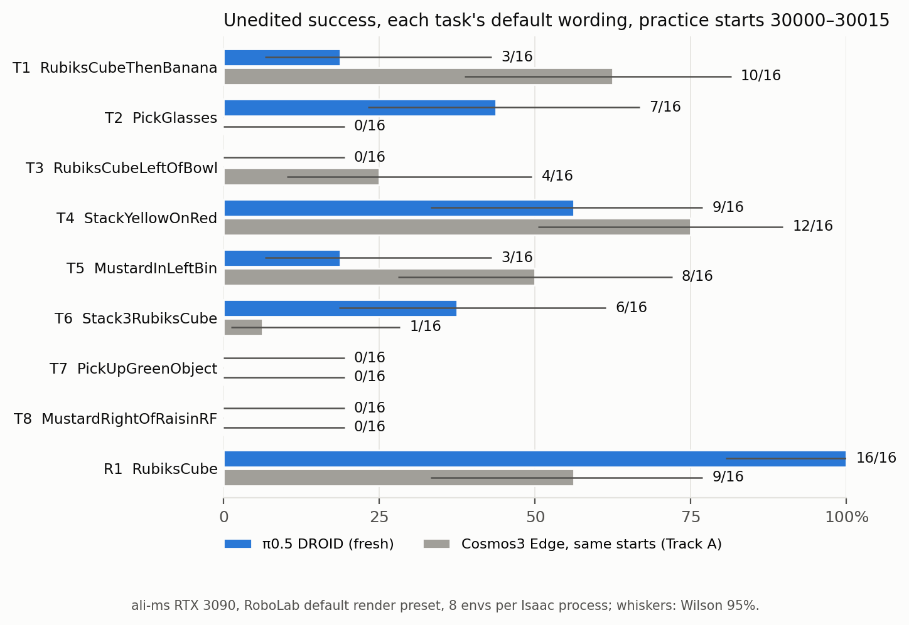
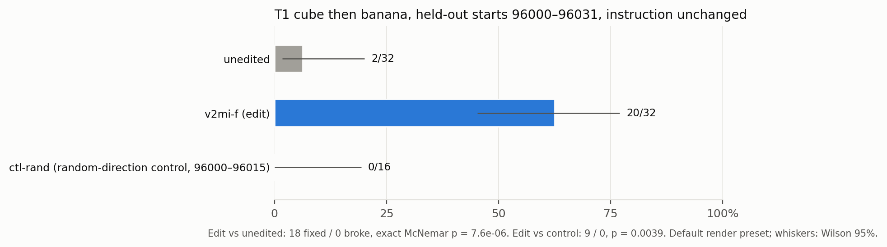
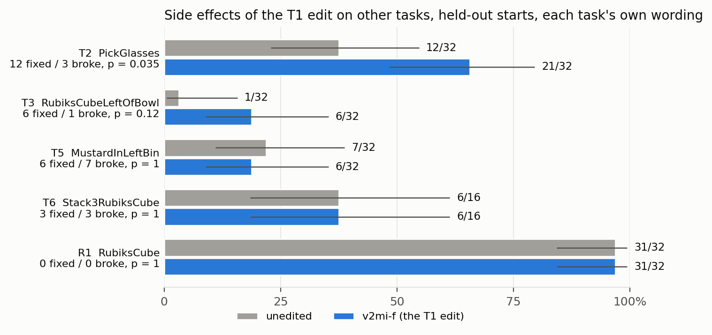
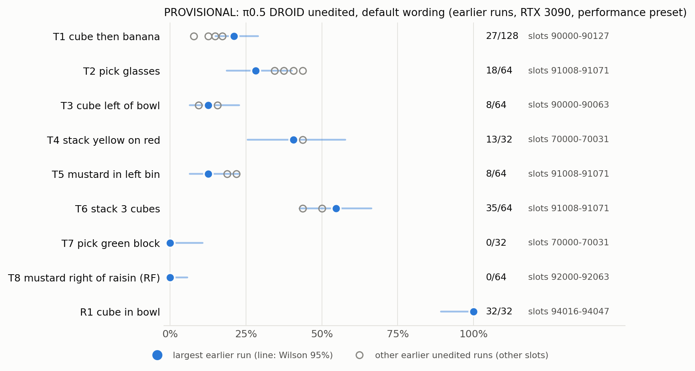
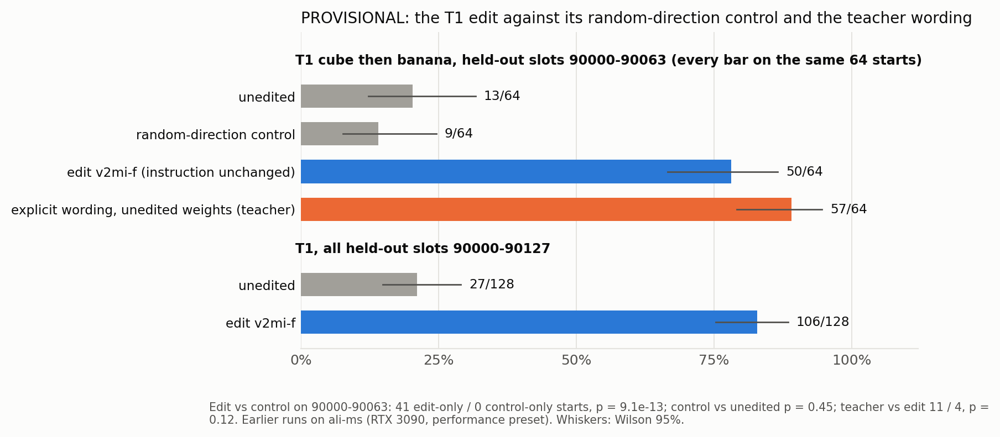
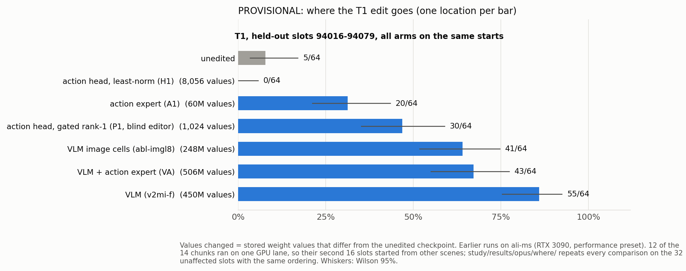
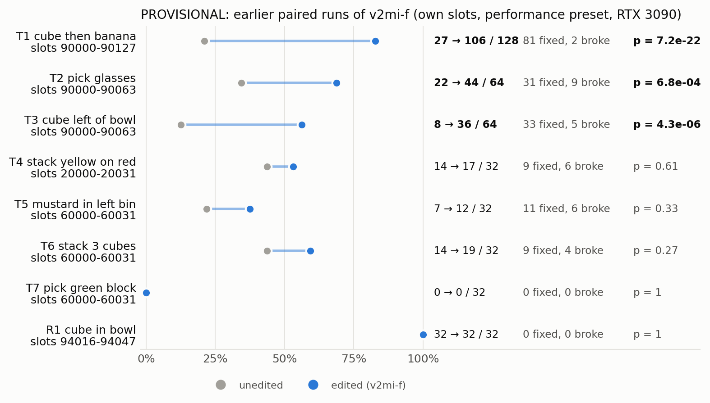
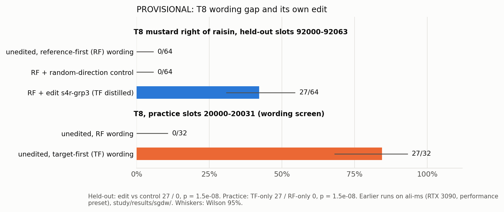

# Track C: π0.5 DROID, the weight-space-programming control

Track C of the three-model WSP comparison: Cosmos3 Edge Policy DROID (Track A), GR00T N1.7 DROID (Track B) and
π0.5 DROID (this track), the model on which weight-space programming was developed. Two parts, kept strictly apart:

1. **FRESH**: new runs on the shared slots (failure map and side-effect map 30000–30031, held-out 96000–96063; every
   16-slot group the first and only run of a fresh Isaac process; environment seed 0) under RoboLab's **default**
   render preset (`balanced`), on a rented pod (2× RTX 4080 SUPER 32 GB). These are the numbers to compare with
   Tracks A and B.
2. **PROVISIONAL**: π0.5 results that existed before this comparison, each on its own slots, on ali-ms (RTX 3090)
   under RoboLab's `performance` preset.

Machine-readable: [`../metrics_pi05.json`](../metrics_pi05.json) (one record per experiment; `"status"` is `"fresh"` or
`"provisional"`, `"render_preset"` and `"hardware"` on every fresh record), `results/runs/` (one file per 16-slot
job, one row per slot), [`results/summary.json`](results/summary.json), [`results/provisional.json`](results/provisional.json).

<!-- summary:begin -->
**Status (2026-11-08 22:50 UTC). Fresh π0.5 numbers are being run on ali-ms (Track C', GPU0, and GPU1 from 22:45 UTC), like for like with Tracks A and B: the same tasks, instructions and slots, RoboLab's default render preset, RTX 3090, and Track A's process layout (8 envs per Isaac process, two fresh processes per 16-slot group, seeds kept identical). Every finished number is in [FRESH (Track C')](#fresh-track-c-ali-ms-gpu0-default-render-preset-the-slots-of-tracks-a-and-b) and in `../metrics_pi05.json` (`"status": "fresh"`, `"run": "C-prime-default"`). The rented pod planned for this earlier could not run Isaac Sim (notes below); the provisional column (earlier runs, other slots, `performance` preset) is kept further down for reference.

**At a glance (PROVISIONAL π0.5 column: earlier runs, own slots, ali-ms RTX 3090, `performance` preset).** Every
comparison is paired on identical starts; p is the exact two-sided McNemar test.

| Question | π0.5 DROID result | Slots |
|---|---|---|
| T1 edit `v2mi-f`, instruction unchanged | 27/128 → **106/128** (81 fixed / 2 broke, p = 7.2 × 10⁻²²) | 90000–90127 |
| T1 random-direction control | 13/64 → 9/64 (6 / 10, p = 0.45); edit vs control 41 / 0 (p = 9.1 × 10⁻¹³) | 90000–90063 |
| T1 explicit wording (teacher), unedited weights | 57/64; the edit recovers 84% of the gap (edit 50/64) | 90000–90063 |
| Side effects of `v2mi-f` (task's own wording) | T2 22/64 → 44/64 (p = 6.8 × 10⁻⁴), T3 8/64 → 36/64 (p = 4.3 × 10⁻⁶); T4–T7 no detectable change at n = 32; R1 32/32 → 32/32; T8 never run | various, see below |
| T8 wording gap (unedited) | RF 0/32 vs TF **27/32** (27 / 0, p = 1.5 × 10⁻⁸) | 20000–20031 |
| T8 own edit `s4r-grp3` (TF distilled), RF wording | 0/64 → **27/64** (27 / 0, p = 1.5 × 10⁻⁸); control 0/64 | 92000–92063 |
| Where the T1 edit goes | VLM 55/64, VLM image cells 41/64, action expert 20/64, action head 0–30/64 (unedited 5/64) | 94016–94079 |
| FRESH (Track C') | see the FRESH (Track C') section: default preset, the slots of Tracks A and B | 30000–30015, 96000–96063 |

Before/after clips: [`videos/`](videos/) (table at the end of the provisional section).
<!-- summary:end -->

## Shared design

| Code | RoboLab task | Default instruction | Episode |
|---|---|---|---|
| T1 | `RubiksCubeThenBananaTask` | Put the cube then the banana in the bowl | 60 s (900 steps) |
| T2 | `PickGlassesTask` | Pick up the eye glasses | 30 s |
| T3 | `RubiksCubeLeftOfBowlTask` | Put the rubiks cube to the left of the bowl | 30 s |
| T4 | `StackYellowOnRedTask` | Stack the yellow block on the red block | 60 s |
| T5 | `MustardInLeftBinTask` | Put the mustard in the left bin | 30 s |
| T6 | `Stack3RubiksCubeTask` | Stack the rubiks cubes in a tower | 60 s |
| T7 | `PickUpGreenObjectTask` | Pick up the green vegetable block | 30 s |
| T8 | `MustardRightOfRaisinRFTask` (`study/results/sgdw/tasks/`, via `WSP_TASK_DIRS`) | Move the mustard bottle on the table so that the raisin box is to the left of the mustard bottle. (reference-first, RF) | 40 s |
| R1 | `RubiksCubeTask` (retention) | Put the cube in the bowl | 40 s |

R1 follows Track A's choice (cube into the bowl, `RubiksCubeTask`), which is also the retention task of π0.5's
earlier where-to-edit study. Known-good ("teacher") wordings for the unedited weights: T1 "Put the cube in the bowl
then put the banana in the bowl" (the explicit wording `v2mi-f` was distilled from); T8 target-first "Move the
mustard bottle on the table so that the mustard bottle is to the right of the raisin box."

## FRESH (Track C'): ali-ms GPU0, default render preset, the slots of Tracks A and B

These are the π0.5 numbers to compare with Cosmos3 Edge (Track A) and GR00T N1.7 (Track B): same RoboLab tasks and
instructions, same slots, same render preset, same GPU model.

| Item | Value |
|---|---|
| Model | `pi05_droid_jointpos` (OpenPI π0.5 DROID, joint position), checkpoint as in the paper; weightsmith @ `ad31044` (`~/cross/pi05/weightsmith`), batched policy server on the same GPU as the simulator (40% memory fraction) |
| Simulator | RoboLab on Isaac Sim (`~/vibes/weight-space-policy-lab/robolab_checkout`), **default render preset** (no `--rendering-type` flag, as Tracks A and B); recorded as `render_preset` in every record |
| GPU | ali-ms RTX 3090 24 GB (Tracks A and B also ran on ali-ms RTX 3090s): GPU0 from 20:04 UTC, plus GPU1 from 22:45 UTC once Track A released it (worker `--gpu 1 --port 8740`, its own flocks). Queues are disjoint and both arms of every paired comparison run on the same GPU (`scripts/tasks.py` `queue_lanes()`; `gpus` in every record). The failure map and T1 held-out 96000–96031 ran on GPU0 |
| Slots | slot s = 16 g + j: group g is the sampling-seed base, slot s gets the noise stream ((g · 64 + j) · 100 + k), environment seed 0. Every 16-slot group is the first and only episode set of a fresh Isaac process (num_runs 1). The first-episode scene is identical across envs and processes (checked from the recorded initial object and robot poses of Track A's T1 run and an earlier π0.5 run), so a slot fixes the scene and the policy's noise seeds; Track A's 8-env processes and our 16-env processes hold the same slots |
| Process layout | **8 envs per Isaac process, two fresh processes per 16-slot group**, as Track A runs Cosmos3 Edge. Env e of the process with offset o (0 or 8) holds slot 16 g + o + e; a one-line patch to this host's `weightsmith/batched_client.py` (`OWSP_ENV_OFFSET`, original kept as `batched_client.py.orig-ad31044`) keeps each slot's noise seeds ((g · 64 + o + e) · 100 + k) identical to a 16-env process. 16 envs did not fit: beside the 9.8 GB policy server the 16-env default-preset process ran out of GPU memory while creating the environment (20:02 UTC; that attempt is in `fresh/aborted/` on ali-ms and is not counted). Every record carries `envs_per_process` and `process_layout`. Checked on T5 (30000–30015): the recorded initial object poses of our offset-8 process equal those of Track A's offset-8 process, and the recorded noise seeds of slot 30008 are 12000800, 12000801, … in both tracks |
| Worker | [`scripts/pool_fresh.py`](scripts/pool_fresh.py): takes the GPU0 flocks (`~/.cache/weightsmith/locks/gpu0.lock`, then `~/vibes/opus-weight-surgery/state/gpu0.lock`), starts the policy server once per run of consecutive jobs with the same weights, runs each group in a new Isaac process, checks the candidate's fingerprint on disk and the server's load report; a crashed process is rerun once in another fresh process |
| Candidates | `v2mi-f` (fingerprint `63db0c52a51306c9`, the paper's T1 edit) and its random-direction control `ctl-rand` (`1efd3512a92642f7`, the same bytes as the paper's `ctl1` control), byte copies in `projects/cross-pi05-t1/cands/` |
| Queue | [`scripts/tasks.py`](scripts/tasks.py) `queue_fresh()`: (1) failure map T1–T8 + R1, unedited, practice 30000–30015; (2) T1 held-out 96000–96063: unedited, `v2mi-f`, `ctl-rand`; (3) side effects of `v2mi-f` on held-out 96000–96031 (T3, T5, then R1, T2, T4, then T6, T7, T8); (4) T8 target-first wording on practice; (5) T1 teacher wording on held-out |
| Metrics | [`scripts/fresh.py`](scripts/fresh.py) → records with `"status": "fresh"`, `"run": "C-prime-default"` in [`../metrics_pi05.json`](../metrics_pi05.json) and [`results/fresh/summary.json`](results/fresh/summary.json); per-job records in `results/fresh/runs/` |

<!-- fresh2:begin -->
Jobs finished: **28** (16 slots each, two fresh 8-env Isaac processes per group); GPU time in finished jobs: **4.32 GPU-h** (ali-ms RTX 3090s: GPU0, and GPU1 from 22:45 UTC; both arms of every pair on one GPU, `gpus` in each record). All rows: default render preset, environment seed 0, arms paired on the same slots (same scene, same noise seeds); p = exact two-sided McNemar; intervals Wilson 95% (rates) and paired bootstrap 95% (differences).

**Failure map** (unedited π0.5, task's default instruction, practice slots). For context, Cosmos3 Edge on the same 16 starts (Track A's run records on ali-ms, default preset, 8 envs per process; `results/fresh/cosmos_same_slots_ali-ms.json`):

| Task | π0.5 unedited | Wilson 95% | Slots | Cosmos3 Edge, same starts | Solved by both |
|---|---|---|---|---|---|
| T1 RubiksCubeThenBananaTask | **3/16** | 7–43% | 30000–30015 | 10/16 | 2 |
| T2 PickGlassesTask | **7/16** | 23–67% | 30000–30015 | 0/16 | 0 |
| T3 RubiksCubeLeftOfBowlTask | **0/16** | 0–19% | 30000–30015 | 4/16 | 0 |
| T4 StackYellowOnRedTask | **9/16** | 33–77% | 30000–30015 | 12/16 | 8 |
| T5 MustardInLeftBinTask | **3/16** | 7–43% | 30000–30015 | 8/16 | 2 |
| T6 Stack3RubiksCubeTask | **6/16** | 18–61% | 30000–30015 | 1/16 | 0 |
| T7 PickUpGreenObjectTask | **0/16** | 0–19% | 30000–30015 | 0/16 | 0 |
| T8 MustardRightOfRaisinRFTask | **0/16** | 0–19% | 30000–30015 | 0/16 | 0 |
| R1 RubiksCubeTask | **16/16** | 81–100% | 30000–30015 | 9/16 | 9 |

**T1 held-out: the distilled edit `v2mi-f` (instruction unchanged)**

| Arm | Success | Paired |
|---|---|---|
| unedited | 2/64 | |
| **`v2mi-f`** | **40/64** | vs unedited: 38 fixed / 0 broke, p = 7.3 × 10-12; difference +46.9 to +71.9 pts |
| random-direction control `ctl-rand` | 0/32 | vs unedited (2/32): 0 fixed / 2 broke, p = 0.50; edit vs control: 20 edit-only / 0 control-only, p = 1.9 × 10-6 |

Slots 96000–96063 (held-out, never used for any choice); control on 96000–96031.

**Side effects of `v2mi-f`** (held-out, each task's own default instruction):

| Task | Unedited → edited | Fixed / broke | Exact p | Slots |
|---|---|---|---|---|
| T3 RubiksCubeLeftOfBowlTask | 1/32 → **6/32** | 6 / 1 | 0.12 | 96000–96031 |
| T5 MustardInLeftBinTask | 7/32 → **6/32** | 6 / 7 | 1.00 | 96000–96031 |

<!-- fresh2:end -->

## FRESH but not run: the pod plan (shared slots, default render preset, RTX 4080 SUPER pod)

**Runtime.** weightsmith @ `ad31044` (this branch's base), installed on the pod by `scripts/fast_setup.sh` (pinned
OpenPI + 1 patch, RoboLab + 6 patches, Isaac Sim 5.0 / Isaac Lab 2.2, checkpoint verified by sha256, base weights
exported once). Evaluation driver: [`scripts/pool_pi05.py`](scripts/pool_pi05.py), one worker per GPU; it calls
weightsmith's own `run_pool` with exactly one 16-slot group per job, so every group is the first and only run of a
fresh Isaac process (16 envs, environment seed 0, noise stream ((g·64 + env)·100 + k) per slot, as Tracks A and B).
Before every candidate job it recomputes the candidate's fingerprint and refuses to run on a mismatch; after it, it
checks that the policy server loaded exactly that workspace. Candidates are byte copies of the published ones on
ali-ms (copied over ssh, fingerprints checked on arrival). Job list, projects and candidates:
[`scripts/tasks.py`](scripts/tasks.py). Tables below are generated by [`scripts/report.py`](scripts/report.py) from
`../metrics_pi05.json`; plots by [`scripts/analyze.py`](scripts/analyze.py).

**Render preset.** Primary: RoboLab's default (no `--rendering-type` flag; Isaac Lab's `RenderCfg` default,
`balanced`), as for Tracks A and B. π0.5's paper results and every provisional number used `performance`; a
`performance` rerun of T1 and T3 on the same slots is the secondary sensitivity check.

**Hardware.** π0.5 runs on RTX 4080 SUPER (32 GB) on the pod; Tracks A and B run on RTX 3090s on ali-ms.
Within-model paired comparisons are unaffected; one T1 group was run on both GPUs under the same preset as a check.

**What happened on the pod.** Setup finished at 06:08 UTC (checkpoint sha256 verified, base weights exported, all
five candidates copied and fingerprint-checked). Both workers then started their first job (T1 and T3, unedited) and
each Isaac Sim process crashed during RTX start-up; the details and the fixes tried are in the status note above and
under *Pod blocker* below. The workers are paused (`PAUSE-gpu0/1` on the pod), the queue is intact
(100 jobs), and nothing from the pod is counted. Cross-model context for the one fresh group below: on the same 16
starts (T1, 30000–30015) Cosmos3 Edge scored 10/16 and GR00T N1.7 4/16 (both default preset, from Tracks A and B's
pushed run records); π0.5 solved 5 of them (under `performance`). Only slot 30008 was solved by all three and 2
by none, so the models fail on largely different starts.

<!-- fresh:begin -->
Jobs finished: **0** (16 slots each); pod GPU time in finished jobs: **0.0 GPU-h**. Every row below pairs arms on the same slots (same scene, same noise seeds), default render preset unless stated.

### Performance-preset group on the shared slots (now provisional; superseded by Track C')

| Task | Unedited | Wilson 95% | Slots | Machine | Preset |
|---|---|---|---|---|---|
| T1 cube then banana | **5/16** | 14–56% | 30000–30015 | ali-ms RTX 3090 | `performance` |

One 16-slot group (first and only run of a fresh Isaac process, environment seed 0), run before the π0.5 queue left ali-ms. It used the `performance` preset, not the default preset of Tracks A and B, so it is not a like-for-like failure-map entry; its record is now labelled `provisional` (`run`: `C-ali-ms-performance-0503`). Per-slot outcomes are in the record.

<!-- fresh:end -->

### Pod blocker

| Check | Result |
|---|---|
| Symptom | every Isaac Sim 5.0 process (RoboLab's eval and a 10-line `AppLauncher(headless=True, enable_cameras=True)` + `new_stage()` test) segfaults in `librtx.scenedb.plugin.so`, called from `omni::usd::UsdManager::createHydraEngine`, before any scene loads |
| GPU / driver | 2× RTX 4080 SUPER 32 GB, driver 595.58.03 (`cuDriverGetVersion` 13020); ali-ms, where the same software stack runs, has driver 535 |
| CUDA itself | fine: `cuInit`, device count, `cuGetProcAddress_v2` for `cuDeviceGetUuid` all succeed from Python; the JAX policy server warms up and serves on both GPUs |
| Warp 1.7.2 (inside Isaac) | `Failed to get driver entry point 'cuDeviceGetUuid' (CUDA error 1)`, then `CUDA error 36: API call is not supported in the installed CUDA driver` in `cuda_init` |
| Vulkan ICD | `WSP_VK_ICD=/etc/vulkan/icd.d/nvidia_icd.json` (the default `/usr/share/...` path does not exist here); the GPUs then enumerate in Kit's GPU table; crash unchanged |
| Missing libraries | `libGLU.so.1`, `libXt.so.6` (iray) installed with apt; crash unchanged |
| `CUDA_VISIBLE_DEVICES` | set: `gpu.foundation` skips both GPUs ("CUDA being in bad state"); unset: GPU 0 active, peer-to-peer check runs; crash unchanged either way |
| RTX settings | `--/renderer/multiGpu/enabled=false --/renderer/activeGpu=0 --/rtx/verifyDriverVersion/enabled=false`, texture streaming off; crash unchanged |
| `libcuda` shim | forwarding `cuGetProcAddress` for the legacy `cuDeviceGetUuid`; crash unchanged |

The NVIDIA graphics user-space libraries are present (GLX/EGL, `glcore`, `glvkspirv`, `gpucomp`, `rtcore`, `nvoptix`).
The evident difference from ali-ms is the driver branch (595 / CUDA 13.2 vs 535); we did not confirm it as the cause.
A pod with a 535–570 driver, or an Isaac Sim build that supports R595, is the next thing to try; the setup, queue and
candidates on this pod can be reused as they are.

## PROVISIONAL: existing π0.5 results (own slots, ali-ms RTX 3090, `performance` preset)

Built by [`scripts/provisional.py`](scripts/provisional.py) from result files already in this repository, plus
[`results/prior_pairs_ali-ms.json`](results/prior_pairs_ali-ms.json), which [`scripts/prior_pairs.py`](scripts/prior_pairs.py)
recomputed from ali-ms's episode records for the earlier side-effect runs. Statistics are recomputed with
`weightsmith.stats`: exact two-sided McNemar test, Wilson 95% intervals, paired bootstrap (20,000 draws, seed 0).

### Unedited success (failure map)

One headline per task (the largest n); every other unedited measurement is listed with its slots. Different blocks
and runs of the same task differ by more than their intervals suggest: identical reruns flip about 30% of pairs.

| Task | Unedited | Wilson 95% | Slots | Other unedited measurements |
|---|---|---|---|---|
| T1 cube then banana | 27/128 | 14.9–29.0% | 90000–90127 | 19/128 on the same slots (second run); 11/64 on 91008–91071; 5/64 on 94016–94079; 4/32 on 70000–70031 |
| T2 pick glasses | 18/64 | 18.6–40.1% | 91008–91071 | 22/64 on 90000–90063; 26/64 on 60000–60063; 12/32 on 70000–70031; 14/32 on 94016–94047 |
| T3 cube left of bowl | 8/64 | 6.5–22.8% | 90000–90063 | 5/32 on 70000–70031; 4/32 on 94016–94047; 3/32 on 60000–60031 |
| T4 stack yellow on red | 13/32 | 25.5–57.7% | 70000–70031 | 14/32 on 20000–20031 |
| T5 mustard in left bin | 8/64 | 6.5–22.8% | 91008–91071 | 6/32 on 70000–70031; 7/32 on 60000–60031 |
| T6 stack 3 cubes | 35/64 | 42.6–66.3% | 91008–91071 | 16/32 on 70000–70031; 14/32 on 60000–60031 |
| T7 pick green block | 0/32 | 0–10.7% | 70000–70031 | 0/32 on 60000–60031 |
| T8 mustard right of raisin (RF) | 0/64 | 0–5.7% | 92000–92063 | 0/32 on 20000–20031 |
| R1 cube in bowl | 32/32 | 89.3–100% | 94016–94047 | 16/16 on 60000–60015 |

### T1: the paper's distilled edits, control and teacher (held-out)

| Edit | Slots | Unedited → edited | Fixed / broke | Exact p | Paired difference, 95% CI | Control | Teacher | Recovery |
|---|---|---|---|---|---|---|---|---|
| `v2mi-f` (VLM layers 0–16; 450,468,837 values, 13.4%) | 90000–90127 | 27/128 → **106/128** | 81 / 2 | 7.2 × 10⁻²² | +61.7 [+52.3, +70.3] pts | 9/64 | 57/64 | 84.1% |
| `abl-imgl8` (image cells, layers 8–16; 0.16% as factors) | 90000–90127 | 19/128 → **102/128** | 86 / 3 | 3.8 × 10⁻²² | +64.8 [+55.5, +73.4] pts | 9/64 | 57/64 | 93.8% |

Control: a random-direction update with `v2mi-f`'s layers, rank and singular values, on slots 90000–90063 (the
unedited runs scored 13/64 and 9/64 there). Teacher: the explicit wording given to the unedited weights, on the
same 64 slots. Recovery = (edited − unedited) / (teacher − unedited) on 90000–90063: `v2mi-f` (50 − 13) / (57 − 13),
`abl-imgl8` (54 − 9) / (57 − 9). Teacher vs `v2mi-f` there: 11 teacher-only and 4 edit-only pairs, p = 0.12.

Slot by slot on 90000–90063 (recomputed tonight from the runs' per-slot records,
[`results/prior_slots_ali-ms.json`](results/prior_slots_ali-ms.json); a `control` record in `../metrics_pi05.json`):
the random-direction control against the unedited run is 6 fixed / 10 broke (13/64 → 9/64, p = 0.45), and the edit
against the control is 41 edit-only / 0 control-only starts (p = 9.1 × 10⁻¹³).

**Where the edit goes** (T1, held-out 94016–94079, all arms paired with one unedited run, 5/64):

| Location | Edited | Fixed / broke | Exact p | Values changed |
|---|---|---|---|---|
| VLM (`v2mi-f`) | **55/64** | 50 / 0 | 1.8 × 10⁻¹⁵ | 450,468,837 |
| VLM image cells (`abl-imgl8`) | 41/64 | 38 / 2 | 1.5 × 10⁻⁹ | 248,057,499 |
| VLM + action expert | 43/64 | 41 / 3 | 1.6 × 10⁻⁹ | 505,694,140 |
| action head, gated rank-1 (blind editor) | 30/64 | 28 / 3 | 4.6 × 10⁻⁶ | 1,024 |
| action expert | 20/64 | 20 / 5 | 0.0041 | 60,378,838 |
| action head, least-norm | 0/64 | 0 / 5 | 0.062 | 8,056 |

Only the VLM edit transferred to other tasks (next table); 12 of these 14 chunks ran on one GPU lane, so their second
16 slots started from other scenes, and `study/results/opus/where/README.md` repeats every comparison on the 32
unaffected slots with the same ordering.

### The existing side-effect map of `v2mi-f` (the T1 edit on other tasks, task's own instruction)

| Task | Slots | Unedited → edited | Fixed / broke | Exact p | Run |
|---|---|---|---|---|---|
| T2 pick glasses | 90000–90063 | 22/64 → **44/64** | 31 / 9 | 6.8 × 10⁻⁴ | held-out (`heldout.py`) |
| T2 pick glasses | 94016–94047 | 14/32 → 25/32 | 15 / 4 | 0.019 | where-to-edit transfer |
| T2 pick glasses | 60000–60063 | 26/64 → 46/64 | 28 / 8 | 0.0012 | practice (2 runs) |
| T3 cube left of bowl | 90000–90063 | 8/64 → **36/64** | 33 / 5 | 4.3 × 10⁻⁶ | held-out (`heldout.py`) |
| T3 cube left of bowl | 94016–94047 | 4/32 → 20/32 | 16 / 0 | 3.1 × 10⁻⁵ | where-to-edit transfer |
| T3 cube left of bowl | 60000–60031 | 3/32 → 22/32 | 20 / 1 | 2.1 × 10⁻⁵ | practice |
| T4 stack yellow on red | 20000–20031 | 14/32 → 17/32 | 9 / 6 | 0.61 | practice |
| T5 mustard in left bin | 60000–60031 | 7/32 → 12/32 | 11 / 6 | 0.33 | practice |
| T6 stack 3 cubes | 60000–60031 | 14/32 → 19/32 | 9 / 4 | 0.27 | practice |
| T7 pick green block | 60000–60031 | 0/32 → 0/32 | 0 / 0 | 1 | practice |
| T8 mustard right of raisin | – | not run | – | – | – |
| R1 cube in bowl | 94016–94047 | 32/32 → 32/32 | 0 / 0 | 1 | where-to-edit retention |
| R1 cube in bowl | 60000–60015 | 16/16 → 16/16 | 0 / 0 | 1 | practice |
| Cube right of bowl | 60000–60031 | 0/32 → 0/32 | 0 / 0 | 1 | practice |
| Block tower (order-agnostic) | 60000–60031 | 15/32 → 14/32 | 7 / 8 | 1 | practice |
| Bowl stacking | 60000–60031 | 19/32 → 21/32 | 8 / 6 | 0.79 | practice |
| Yogurt in bowl | 60000–60031 | 3/32 → 2/32 | 2 / 3 | 1 | practice |
| Grab a bagel | 60000–60031 | 0/32 → 1/32 | 1 / 0 | 1 | practice |
| Marker in mug | 60000–60031 | 0/32 → 1/32 | 1 / 0 | 1 | practice |
| Butter onto raisin box | 60000–60015 | 14/16 → 10/16 | 0 / 4 | 0.12 | practice; an unedited rerun scored 8/16 |
| Banana onto plate | 60000–60015 | 16/16 → 16/16 | 0 / 0 | 1 | practice |

Practice rows ran through `owsp eval` with the edit after the unedited arm in the same project; chunks of more than 16
slots could start later groups from other scenes, which weakens their pairing (not their counts).

Per shared task, the largest earlier paired run (held-out first). T8 was never run with `v2mi-f` before tonight.

### T8: the wording gap and its own edit

| Comparison | Slots | Result | Fixed / broke | Exact p |
|---|---|---|---|---|
| unedited, RF vs TF wording | 20000–20031 | RF 0/32, TF **27/32** | 27 TF-only / 0 | 1.5 × 10⁻⁸ |
| `s4r-grp3` (TF distilled into VLM layers 8–16, 3 key groups) vs unedited, RF | 92000–92063 (held-out) | 0/64 → **27/64** | 27 / 0 | 1.5 × 10⁻⁸ |
| random-direction control of `s4r-grp3`, RF | 92000–92063 | 0/64 | 0 / 0 | 1 |
| `s4r-grp3` vs unedited, under TF (no harm) | 20000–20031 | 27/32 → 23/32 | 5 / 9 | 0.42 |

Recovery (practice slots, the only ones with a teacher arm): RF + `s4r-grp3` 16/32 against RF 0/32 and TF 27/32,
59.3%. The paper's T1 edit `v2mi-f` was never run on T8. Source: `study/results/sgdw/`. Slot by slot on the
held-out block the control solves none of the 27 starts the edit solves (edit vs control 27 / 0, p = 1.5 × 10⁻⁸;
`control` record for T8).

### Before/after clips (provisional)

Episode videos that the earlier held-out runs recorded on ali-ms, stacked so every panel shows the same start (scene
and noise seeds) under a different arm, 3× speed, labelled with RoboLab's verdict. Slots are not hand-picked: each clip
takes the lowest slot of its block that has the clip's outcome pattern and was the first group of its Isaac process in
every arm; the first frames of the panels are compared (PSNR in `videos/clips.json`) to confirm the shared start.
Built by [`scripts/prov_clips.py`](scripts/prov_clips.py) (CPU only).

| Clip | Panels (top to bottom) | What it shows |
|---|---|---|
| [`t1_v2mi-f_vs_control_vs_teacher_90000.mp4`](videos/t1_v2mi-f_vs_control_vs_teacher_90000.mp4) | unedited, random control, `v2mi-f`, explicit wording | T1: unedited and control fail, the edit and the reworded instruction succeed |
| [`t1_v2mi-f_second_lane_90064.mp4`](videos/t1_v2mi-f_second_lane_90064.mp4) | unedited, `v2mi-f` | T1 on the second held-out lane |
| [`t3_v2mi-f_side_effect_fixed_90000.mp4`](videos/t3_v2mi-f_side_effect_fixed_90000.mp4) | unedited, `v2mi-f` | the T1 edit also fixes a T3 start (cube left of bowl) |
| [`t2_v2mi-f_side_effect_fixed_90000.mp4`](videos/t2_v2mi-f_side_effect_fixed_90000.mp4) | unedited, `v2mi-f` | the T1 edit also fixes a T2 start (pick glasses) |
| [`t2_v2mi-f_side_effect_broke_90001.mp4`](videos/t2_v2mi-f_side_effect_broke_90001.mp4) | unedited, `v2mi-f` | one of the 9 T2 starts the edit breaks |
| [`t8_s4r-grp3_vs_control_92001.mp4`](videos/t8_s4r-grp3_vs_control_92001.mp4) | unedited RF, random control, `s4r-grp3` | T8: the distilled wording edit moves the mustard right of the raisin box; the control does not |

## GPU time

| Machine | GPU time | What |
|---|---|---|
| ali-ms | 10.4 GPU-min (GPU1 506.7 s, GPU0 117.2 s) | one T1 unedited group (30000–30015, `performance`, 5/16; kept as the 3090 side of the hardware check) and a stopped job |
| pod | about 20 GPU-min, no completed episode | two workers' first jobs (policy server warm-up, then Isaac crashes) 06:08–06:16 UTC and three single-process Isaac start-up tests |

## Files

| Path | What |
|---|---|
| `scripts/tasks.py` | task set, wordings, projects, candidates and fingerprints, job queue (priority order) |
| `scripts/pool_pi05.py` | evaluation worker (one per GPU; flocks; one fresh Isaac process per 16-slot group) |
| `scripts/analyze.py` | `../metrics_pi05.json`, `results/summary.json`, plots |
| `scripts/report.py` | the fresh tables of this page, from `../metrics_pi05.json` |
| `scripts/make_clips.py` | before/after clips from the same start (pod) |
| `scripts/sync_pod.sh` | copies the pod's run records here and rebuilds everything |
| `scripts/provisional.py`, `scripts/prior_pairs.py` | the provisional column from existing results and ali-ms episode records |
| `scripts/prov_clips.py` | the provisional before/after clips and `results/prior_slots_ali-ms.json` (per-slot outcomes of the earlier runs they use) |
| `results/` | `runs/` (pod, one file per job; empty), `runs_ali-ms/`, `provisional.json`, `prior_pairs_ali-ms.json`, `prior_slots_ali-ms.json`, `summary.json` |
| `plots/` | SVG and PNG (2×) |
| `videos/` | provisional before/after clips (H.264, ≤ 2 MB each, the 4-panel one 2.5 MB) and `clips.json` |
